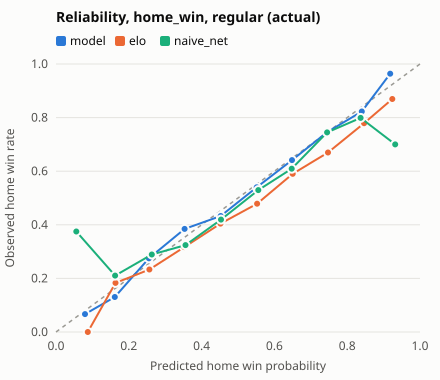
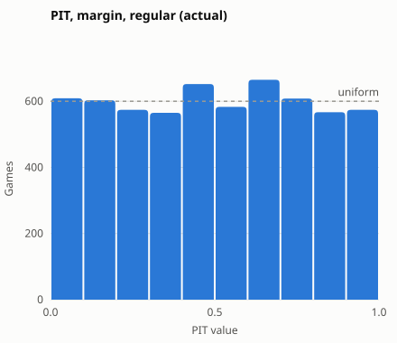
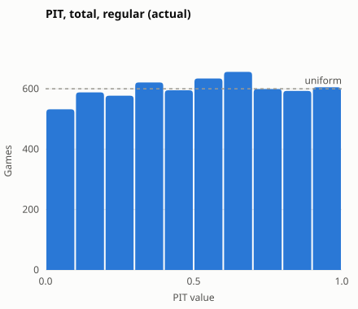

# Evaluation 2020-21 to 2024-25

## Run: actual availability

- **Seasons:** 2020-21 to 2024-25; weekly refits, frozen config
- **Availability at test time:** `actual`; training, calibration and sigma use who actually played
- **CIs:** 95% percentile bootstrap over games (1000 replicates); `vs Elo` is the paired difference (negative is better, except accuracy). ECE is biased upward under resampling, so its interval can sit above the estimate

### Where the model does not beat Elo

| target | scope | metric | model | elo | diff | diff_lo | diff_hi | verdict |
|---|---|---|---|---|---|---|---|---|
| home_win | play_in | ece | 0.0909 | 0.0188 | 0.0722 | -0.0924 | 0.1503 | worse |
| margin | play_in | mae | 11.1767 | 10.9392 | 0.2375 | -0.4378 | 0.9018 | worse |
| margin | play_in | rmse | 13.8983 | 13.7472 | 0.1511 | -0.4084 | 0.7091 | worse |
| total | preseason | rmse | 18.3544 | 18.2080 | 0.1464 | -0.8145 | 1.1398 | worse |
| home_win | preseason | accuracy | 0.5619 | 0.5559 | 0.0060 | -0.0272 | 0.0423 | not significantly better |
| home_win | play_in | log_loss | 0.6248 | 0.6305 | -0.0057 | -0.0527 | 0.0413 | not significantly better |
| home_win | play_in | brier | 0.2169 | 0.2196 | -0.0027 | -0.0253 | 0.0194 | not significantly better |
| home_win | play_in | accuracy | 0.7000 | 0.6667 | 0.0333 | -0.0667 | 0.1667 | not significantly better |
| home_win | playoffs | log_loss | 0.6495 | 0.6572 | -0.0077 | -0.0183 | 0.0028 | not significantly better |
| home_win | playoffs | brier | 0.2284 | 0.2319 | -0.0034 | -0.0085 | 0.0014 | not significantly better |
| home_win | playoffs | accuracy | 0.6351 | 0.6090 | 0.0261 | -0.0071 | 0.0617 | not significantly better |
| home_win | playoffs | ece | 0.0195 | 0.0544 | -0.0349 | -0.0576 | 0.0197 | not significantly better |
| home_win | postseason | log_loss | 0.6479 | 0.6555 | -0.0076 | -0.0171 | 0.0027 | not significantly better |
| home_win | postseason | brier | 0.2276 | 0.2310 | -0.0034 | -0.0081 | 0.0016 | not significantly better |
| home_win | postseason | accuracy | 0.6394 | 0.6128 | 0.0265 | -0.0045 | 0.0597 | not significantly better |
| home_win | postseason | ece | 0.0233 | 0.0499 | -0.0266 | -0.0551 | 0.0231 | not significantly better |
| margin | postseason | rmse | 14.6887 | 14.9445 | -0.2558 | -0.5303 | 0.0104 | not significantly better |
| total | preseason | mae | 14.0608 | 14.2043 | -0.1434 | -0.8188 | 0.6242 | not significantly better |

## home_win (actual availability)

**regular** (6000 games)

| model | log_loss | log_loss vs Elo | brier | brier vs Elo | accuracy | accuracy vs Elo | ece | ece vs Elo |
|---|---|---|---|---|---|---|---|---|
| model | 0.6164 [0.6077, 0.6261] | -0.0226 [-0.0276, -0.0174] | 0.2141 [0.2103, 0.2186] | -0.0095 [-0.0115, -0.0074] | 0.6567 [0.6443, 0.6682] | 0.0180 [0.0087, 0.0275] | 0.0144 [0.0108, 0.0285] | -0.0465 [-0.0538, -0.0281] |
| elo | 0.6389 [0.6282, 0.6497] | ref | 0.2236 [0.2190, 0.2284] | ref | 0.6387 [0.6257, 0.6508] | ref | 0.0608 [0.0501, 0.0724] | ref |
| naive_home | 0.6884 [0.6856, 0.6912] | 0.0495 [0.0396, 0.0591] | 0.2476 [0.2462, 0.2490] | 0.0240 [0.0197, 0.0281] | 0.5512 [0.5390, 0.5635] | -0.0875 [-0.0998, -0.0740] | 0.0038 [0.0002, 0.0162] | -0.0571 [-0.0618, -0.0416] |
| naive_net | 0.6457 [0.6362, 0.6553] | 0.0068 [-0.0004, 0.0134] | 0.2257 [0.2216, 0.2298] | 0.0021 [-0.0004, 0.0046] | 0.6315 [0.6202, 0.6437] | -0.0072 [-0.0158, 0.0010] | 0.0300 [0.0212, 0.0428] | -0.0308 [-0.0345, -0.0213] |

**preseason** (331 games)

| model | log_loss | log_loss vs Elo | brier | brier vs Elo | accuracy | accuracy vs Elo | ece | ece vs Elo |
|---|---|---|---|---|---|---|---|---|
| model | 0.6863 [0.6543, 0.7185] | -0.0475 [-0.0702, -0.0227] | 0.2468 [0.2322, 0.2620] | -0.0178 [-0.0268, -0.0078] | 0.5619 [0.5106, 0.6163] | 0.0060 [-0.0272, 0.0423] | 0.0972 [0.0588, 0.1522] | -0.0368 [-0.0753, -0.0030] |
| elo | 0.7337 [0.6878, 0.7830] | ref | 0.2646 [0.2446, 0.2862] | ref | 0.5559 [0.5014, 0.6073] | ref | 0.1340 [0.0965, 0.1902] | ref |
| naive_home | 0.6809 [0.6686, 0.6934] | -0.0528 [-0.0937, -0.0106] | 0.2439 [0.2378, 0.2501] | -0.0207 [-0.0382, -0.0029] | 0.5801 [0.5257, 0.6344] | 0.0242 [-0.0302, 0.0816] | 0.0263 [0.0012, 0.0805] | -0.1078 [-0.1725, -0.0479] |
| naive_net | 0.6808 [0.6612, 0.7003] | -0.0529 [-0.0922, -0.0138] | 0.2439 [0.2342, 0.2535] | -0.0207 [-0.0369, -0.0039] | 0.5801 [0.5257, 0.6344] | 0.0242 [-0.0302, 0.0816] | 0.0080 [0.0012, 0.0653] | -0.1261 [-0.1767, -0.0686] |

**play_in** (30 games)

| model | log_loss | log_loss vs Elo | brier | brier vs Elo | accuracy | accuracy vs Elo | ece | ece vs Elo |
|---|---|---|---|---|---|---|---|---|
| model | 0.6248 [0.5471, 0.7075] | -0.0057 [-0.0527, 0.0413] | 0.2169 [0.1792, 0.2569] | -0.0027 [-0.0253, 0.0194] | 0.7000 [0.5333, 0.8667] | 0.0333 [-0.0667, 0.1667] | 0.0909 [0.0467, 0.2658] | 0.0722 [-0.0924, 0.1503] |
| elo | 0.6305 [0.5283, 0.7390] | ref | 0.2196 [0.1711, 0.2716] | ref | 0.6667 [0.5000, 0.8333] | ref | 0.0188 [0.0296, 0.2243] | ref |
| naive_home | 0.6715 [0.6380, 0.7095] | 0.0410 [-0.0348, 0.1146] | 0.2392 [0.2225, 0.2582] | 0.0196 [-0.0159, 0.0544] | 0.6667 [0.5000, 0.8333] | 0.0000 [0.0000, 0.0000] | 0.1156 [0.0138, 0.2816] | 0.0968 [-0.1614, 0.1111] |
| naive_net | 0.6361 [0.5671, 0.7092] | 0.0056 [-0.0540, 0.0590] | 0.2222 [0.1886, 0.2577] | 0.0026 [-0.0251, 0.0274] | 0.6667 [0.5000, 0.8333] | 0.0000 [0.0000, 0.0000] | 0.0665 [0.0234, 0.2303] | 0.0477 [-0.1368, 0.1040] |

**playoffs** (422 games)

| model | log_loss | log_loss vs Elo | brier | brier vs Elo | accuracy | accuracy vs Elo | ece | ece vs Elo |
|---|---|---|---|---|---|---|---|---|
| model | 0.6495 [0.6188, 0.6809] | -0.0077 [-0.0183, 0.0028] | 0.2284 [0.2143, 0.2428] | -0.0034 [-0.0085, 0.0014] | 0.6351 [0.5876, 0.6802] | 0.0261 [-0.0071, 0.0617] | 0.0195 [0.0247, 0.0799] | -0.0349 [-0.0576, 0.0197] |
| elo | 0.6572 [0.6239, 0.6903] | ref | 0.2319 [0.2167, 0.2469] | ref | 0.6090 [0.5616, 0.6541] | ref | 0.0544 [0.0342, 0.1080] | ref |
| naive_home | 0.6815 [0.6713, 0.6921] | 0.0243 [-0.0015, 0.0511] | 0.2442 [0.2391, 0.2495] | 0.0124 [0.0007, 0.0241] | 0.5829 [0.5355, 0.6303] | -0.0261 [-0.0569, 0.0071] | 0.0304 [0.0015, 0.0773] | -0.0240 [-0.0875, 0.0308] |
| naive_net | 0.6511 [0.6242, 0.6761] | -0.0061 [-0.0212, 0.0087] | 0.2294 [0.2168, 0.2414] | -0.0024 [-0.0091, 0.0040] | 0.6351 [0.5900, 0.6801] | 0.0261 [0.0000, 0.0546] | 0.0439 [0.0258, 0.0934] | -0.0105 [-0.0627, 0.0406] |

**postseason** (452 games)

| model | log_loss | log_loss vs Elo | brier | brier vs Elo | accuracy | accuracy vs Elo | ece | ece vs Elo |
|---|---|---|---|---|---|---|---|---|
| model | 0.6479 [0.6206, 0.6769] | -0.0076 [-0.0171, 0.0027] | 0.2276 [0.2151, 0.2409] | -0.0034 [-0.0081, 0.0016] | 0.6394 [0.5929, 0.6836] | 0.0265 [-0.0045, 0.0597] | 0.0233 [0.0220, 0.0792] | -0.0266 [-0.0551, 0.0231] |
| elo | 0.6555 [0.6269, 0.6873] | ref | 0.2310 [0.2182, 0.2458] | ref | 0.6128 [0.5686, 0.6527] | ref | 0.0499 [0.0293, 0.0998] | ref |
| naive_home | 0.6809 [0.6711, 0.6915] | 0.0254 [0.0013, 0.0482] | 0.2439 [0.2390, 0.2492] | 0.0128 [0.0018, 0.0229] | 0.5885 [0.5420, 0.6328] | -0.0243 [-0.0553, 0.0088] | 0.0361 [0.0031, 0.0810] | -0.0138 [-0.0854, 0.0380] |
| naive_net | 0.6501 [0.6280, 0.6764] | -0.0053 [-0.0191, 0.0082] | 0.2289 [0.2185, 0.2410] | -0.0021 [-0.0083, 0.0038] | 0.6372 [0.5907, 0.6792] | 0.0243 [-0.0022, 0.0509] | 0.0389 [0.0218, 0.0905] | -0.0109 [-0.0553, 0.0371] |

**log_loss by season (regular season)**

| season | model | elo | naive_home | naive_net | games |
|---|---|---|---|---|---|
| 2020-21 | 0.6285 | 0.6451 | 0.6904 | 0.6649 | 1080 |
| 2021-22 | 0.6230 | 0.6493 | 0.6899 | 0.6619 | 1230 |
| 2022-23 | 0.6374 | 0.6538 | 0.6823 | 0.6547 | 1230 |
| 2023-24 | 0.5979 | 0.6243 | 0.6904 | 0.6286 | 1230 |
| 2024-25 | 0.5963 | 0.6228 | 0.6893 | 0.6206 | 1230 |

## margin (actual availability)

**regular** (6000 games)

| model | mae | mae vs Elo | rmse | rmse vs Elo | coverage_80 | coverage_80 vs Elo |
|---|---|---|---|---|---|---|
| model | 10.67 [10.45, 10.89] | -0.3221 [-0.3958, -0.2513] | 13.67 [13.39, 13.94] | -0.3592 [-0.4306, -0.2872] | 0.8028 [0.7925, 0.8132] | 0.0033 [-0.0023, 0.0088] |
| elo | 10.99 [10.76, 11.22] | ref | 14.03 [13.75, 14.30] | ref | 0.7995 [0.7895, 0.8098] | ref |
| naive_home | 12.06 [11.81, 12.29] | 1.0628 [0.9380, 1.1838] | 15.16 [14.86, 15.46] | 1.1382 [1.0015, 1.2638] | 0.8033 [0.7932, 0.8140] | 0.0038 [-0.0038, 0.0118] |
| naive_net | 11.20 [10.97, 11.42] | 0.2024 [0.1272, 0.2748] | 14.26 [13.97, 14.54] | 0.2292 [0.1427, 0.3097] | 0.8003 [0.7898, 0.8110] | 0.0008 [-0.0045, 0.0063] |

**preseason** (331 games)

| model | mae | mae vs Elo | rmse | rmse vs Elo | coverage_80 | coverage_80 vs Elo |
|---|---|---|---|---|---|---|
| model | 12.49 [11.35, 13.66] | -1.0549 [-1.5619, -0.5142] | 16.42 [14.91, 17.96] | -1.3081 [-2.0167, -0.6156] | 0.8248 [0.7825, 0.8640] | 0.0091 [-0.0152, 0.0332] |
| elo | 13.55 [12.29, 14.83] | ref | 17.73 [16.05, 19.42] | ref | 0.8157 [0.7704, 0.8580] | ref |
| naive_home | 13.09 [11.79, 14.40] | -0.4556 [-0.9121, 0.0561] | 17.55 [15.84, 19.33] | -0.1840 [-0.6133, 0.2953] | 0.8308 [0.7885, 0.8701] | 0.0151 [-0.0030, 0.0332] |
| naive_net | 13.08 [11.82, 14.37] | -0.4622 [-0.8868, 0.0337] | 17.50 [15.84, 19.29] | -0.2342 [-0.6459, 0.2161] | 0.8308 [0.7885, 0.8701] | 0.0151 [-0.0030, 0.0332] |

**play_in** (30 games)

| model | mae | mae vs Elo | rmse | rmse vs Elo | coverage_80 | coverage_80 vs Elo |
|---|---|---|---|---|---|---|
| model | 11.18 [8.4965, 14.02] | 0.2375 [-0.4378, 0.9018] | 13.90 [11.13, 16.37] | 0.1511 [-0.4084, 0.7091] | 0.7333 [0.5667, 0.8667] | 0.0000 [-0.1000, 0.1000] |
| elo | 10.94 [8.2392, 13.79] | ref | 13.75 [10.89, 16.27] | ref | 0.7333 [0.5667, 0.8667] | ref |
| naive_home | 11.72 [9.1107, 14.47] | 0.7772 [0.0000, 1.5913] | 14.22 [11.25, 16.86] | 0.4749 [-0.4322, 1.2757] | 0.7333 [0.5667, 0.8667] | 0.0000 [-0.1000, 0.1000] |
| naive_net | 11.21 [8.5018, 14.00] | 0.2726 [-0.3508, 0.8500] | 13.68 [10.90, 16.26] | -0.0694 [-0.7595, 0.5280] | 0.7667 [0.6000, 0.9000] | 0.0333 [0.0000, 0.1000] |

**playoffs** (422 games)

| model | mae | mae vs Elo | rmse | rmse vs Elo | coverage_80 | coverage_80 vs Elo |
|---|---|---|---|---|---|---|
| model | 11.66 [10.78, 12.51] | -0.3419 [-0.5871, -0.1079] | 14.74 [13.65, 15.73] | -0.2827 [-0.5680, -0.0179] | 0.8128 [0.7749, 0.8483] | 0.0308 [0.0118, 0.0545] |
| elo | 12.00 [11.12, 12.88] | ref | 15.03 [13.92, 16.09] | ref | 0.7820 [0.7393, 0.8199] | ref |
| naive_home | 12.56 [11.65, 13.44] | 0.5596 [0.2740, 0.8621] | 15.64 [14.51, 16.73] | 0.6118 [0.2857, 0.9395] | 0.7962 [0.7559, 0.8318] | 0.0142 [-0.0071, 0.0355] |
| naive_net | 11.91 [11.00, 12.75] | -0.0912 [-0.2700, 0.0816] | 15.01 [13.87, 16.11] | -0.0126 [-0.1823, 0.1655] | 0.7867 [0.7464, 0.8246] | 0.0047 [-0.0142, 0.0237] |

**postseason** (452 games)

| model | mae | mae vs Elo | rmse | rmse vs Elo | coverage_80 | coverage_80 vs Elo |
|---|---|---|---|---|---|---|
| model | 11.63 [10.81, 12.53] | -0.3034 [-0.5437, -0.0619] | 14.69 [13.66, 15.76] | -0.2558 [-0.5303, 0.0104] | 0.8075 [0.7699, 0.8407] | 0.0288 [0.0088, 0.0509] |
| elo | 11.93 [11.13, 12.82] | ref | 14.94 [13.94, 16.01] | ref | 0.7788 [0.7389, 0.8142] | ref |
| naive_home | 12.50 [11.73, 13.41] | 0.5741 [0.3039, 0.8555] | 15.55 [14.52, 16.60] | 0.6033 [0.3183, 0.9027] | 0.7920 [0.7522, 0.8296] | 0.0133 [-0.0066, 0.0354] |
| naive_net | 11.86 [11.08, 12.78] | -0.0670 [-0.2362, 0.1078] | 14.93 [13.94, 16.01] | -0.0160 [-0.1726, 0.1493] | 0.7854 [0.7456, 0.8186] | 0.0066 [-0.0089, 0.0265] |

**mae by season (regular season)**

| season | model | elo | naive_home | naive_net | games |
|---|---|---|---|---|---|
| 2020-21 | 10.8619 | 11.2163 | 12.0990 | 11.4674 | 1080 |
| 2021-22 | 10.9236 | 11.2487 | 12.2363 | 11.5209 | 1230 |
| 2022-23 | 10.0424 | 10.2163 | 10.8978 | 10.3542 | 1230 |
| 2023-24 | 10.7852 | 11.1599 | 12.4478 | 11.3492 | 1230 |
| 2024-25 | 10.7650 | 11.1513 | 12.6036 | 11.3189 | 1230 |

## total (actual availability)

**regular** (6000 games)

| model | mae | mae vs Elo | rmse | rmse vs Elo | coverage_80 | coverage_80 vs Elo |
|---|---|---|---|---|---|---|
| model | 14.63 [14.36, 14.91] | -1.0765 [-1.2429, -0.9235] | 18.45 [18.10, 18.84] | -1.3555 [-1.5407, -1.1841] | 0.8105 [0.7998, 0.8200] | 0.0050 [-0.0028, 0.0132] |
| elo | 15.70 [15.39, 16.04] | ref | 19.81 [19.43, 20.24] | ref | 0.8055 [0.7943, 0.8153] | ref |
| naive_home | 15.88 [15.57, 16.22] | 0.1790 [0.1267, 0.2323] | 20.03 [19.63, 20.43] | 0.2218 [0.1693, 0.2737] | 0.8155 [0.8045, 0.8247] | 0.0100 [0.0055, 0.0143] |
| naive_net | 14.99 [14.71, 15.31] | -0.7092 [-0.8443, -0.5868] | 18.93 [18.56, 19.34] | -0.8761 [-1.0212, -0.7479] | 0.8093 [0.7992, 0.8195] | 0.0038 [-0.0032, 0.0115] |

**preseason** (331 games)

| model | mae | mae vs Elo | rmse | rmse vs Elo | coverage_80 | coverage_80 vs Elo |
|---|---|---|---|---|---|---|
| model | 14.06 [12.81, 15.46] | -0.1434 [-0.8188, 0.6242] | 18.35 [16.75, 20.05] | 0.1464 [-0.8145, 1.1398] | 0.8338 [0.7915, 0.8731] | 0.0000 [-0.0302, 0.0332] |
| elo | 14.20 [13.04, 15.45] | ref | 18.21 [16.78, 19.81] | ref | 0.8338 [0.7915, 0.8701] | ref |
| naive_home | 14.40 [13.25, 15.68] | 0.1975 [-0.1023, 0.4893] | 18.38 [16.92, 19.97] | 0.1697 [-0.1435, 0.4775] | 0.8097 [0.7674, 0.8459] | -0.0242 [-0.0514, 0.0000] |
| naive_net | 14.93 [13.76, 16.25] | 0.7235 [0.4443, 1.0098] | 19.08 [17.57, 20.74] | 0.8719 [0.6049, 1.1140] | 0.8369 [0.7975, 0.8702] | 0.0030 [-0.0151, 0.0211] |

**play_in** (30 games)

| model | mae | mae vs Elo | rmse | rmse vs Elo | coverage_80 | coverage_80 vs Elo |
|---|---|---|---|---|---|---|
| model | 12.94 [9.6820, 16.20] | -3.2895 [-6.0292, -0.8478] | 15.51 [11.97, 18.88] | -3.3440 [-6.0329, -0.8594] | 0.9000 [0.8000, 1.0000] | 0.0667 [0.0000, 0.1667] |
| elo | 16.23 [12.95, 19.50] | ref | 18.85 [15.01, 22.11] | ref | 0.8333 [0.7000, 0.9667] | ref |
| naive_home | 15.75 [12.25, 19.15] | -0.4781 [-1.5424, 0.4796] | 18.57 [14.58, 22.11] | -0.2780 [-1.2025, 0.5470] | 0.8333 [0.7000, 0.9667] | 0.0000 [0.0000, 0.0000] |
| naive_net | 15.28 [12.07, 18.34] | -0.9470 [-2.5711, 0.6327] | 17.65 [14.28, 20.61] | -1.1995 [-2.8546, 0.4548] | 0.8333 [0.7000, 0.9667] | 0.0000 [-0.1000, 0.1000] |

**playoffs** (422 games)

| model | mae | mae vs Elo | rmse | rmse vs Elo | coverage_80 | coverage_80 vs Elo |
|---|---|---|---|---|---|---|
| model | 14.93 [13.84, 16.06] | -2.4526 [-3.3368, -1.5855] | 18.91 [17.59, 20.20] | -2.6038 [-3.4728, -1.7261] | 0.8104 [0.7701, 0.8483] | 0.0237 [-0.0119, 0.0592] |
| elo | 17.39 [16.14, 18.72] | ref | 21.51 [20.15, 22.84] | ref | 0.7867 [0.7464, 0.8246] | ref |
| naive_home | 17.64 [16.42, 18.99] | 0.2505 [-0.0141, 0.5146] | 21.75 [20.41, 23.18] | 0.2334 [-0.0289, 0.5108] | 0.7773 [0.7370, 0.8152] | -0.0095 [-0.0308, 0.0118] |
| naive_net | 17.33 [16.16, 18.55] | -0.0517 [-0.5237, 0.4135] | 21.31 [20.01, 22.64] | -0.2039 [-0.6652, 0.2821] | 0.7725 [0.7299, 0.8104] | -0.0142 [-0.0427, 0.0095] |

**postseason** (452 games)

| model | mae | mae vs Elo | rmse | rmse vs Elo | coverage_80 | coverage_80 vs Elo |
|---|---|---|---|---|---|---|
| model | 14.80 [13.77, 15.87] | -2.5081 [-3.3050, -1.6201] | 18.70 [17.52, 19.94] | -2.6440 [-3.4581, -1.7649] | 0.8164 [0.7788, 0.8518] | 0.0265 [-0.0088, 0.0619] |
| elo | 17.31 [16.16, 18.49] | ref | 21.35 [20.05, 22.60] | ref | 0.7898 [0.7522, 0.8274] | ref |
| naive_home | 17.51 [16.34, 18.66] | 0.2021 [-0.0556, 0.4485] | 21.55 [20.22, 22.79] | 0.2037 [-0.0470, 0.4612] | 0.7810 [0.7434, 0.8186] | -0.0088 [-0.0310, 0.0111] |
| naive_net | 17.20 [16.10, 18.38] | -0.1112 [-0.5503, 0.3581] | 21.09 [19.83, 22.38] | -0.2606 [-0.6996, 0.2416] | 0.7765 [0.7345, 0.8142] | -0.0133 [-0.0377, 0.0111] |

**mae by season (regular season)**

| season | model | elo | naive_home | naive_net | games |
|---|---|---|---|---|---|
| 2020-21 | 14.7635 | 15.6980 | 15.7027 | 14.9640 | 1080 |
| 2021-22 | 14.7483 | 15.6466 | 16.1276 | 15.1305 | 1230 |
| 2022-23 | 14.4712 | 15.2192 | 15.4490 | 14.6366 | 1230 |
| 2023-24 | 14.6372 | 16.0721 | 16.1548 | 15.2867 | 1230 |
| 2024-25 | 14.5342 | 15.8838 | 15.9595 | 14.9529 | 1230 |

### Calibration (actual availability)

### Drivers (actual availability)

- Mean absolute contribution per family, regular season (log-odds for `home_win`, points otherwise)

| target | rung | elo | form | rest_travel | availability | home_court | game_type | league |
|---|---|---|---|---|---|---|---|---|
| home_win | linear | 0.3890 | 0.2030 | 0.0840 | 0.2050 | 0.0130 | 0.0060 | 0.0260 |
| margin | lgbm | 2.7230 | 1.7010 | 0.3570 | 1.5940 | 0.0260 | 0.0050 | 0.1100 |
| total | linear | 0.3320 | 19.7370 | 0.6380 | 0.9740 | 0.1660 | 0.6210 | 6.2540 |

- Check: base + contributions = raw output for every prediction

| target | n | max_gap | max_pred_gap |
|---|---|---|---|
| home_win | 6785 | 0.0000 | 0.0000 |
| margin | 6785 | 0.0000 | 0 |
| total | 6785 | 0.0000 | 0 |

## Availability era shift (issue #7)

| season | team_games | full_strength | lost_actual | lost_report | report_share |
|---|---|---|---|---|---|
| 2012-13 | 2428 | 84.3520 | 10.8240 | 0 | 0 |
| 2013-14 | 2430 | 85.9720 | 11.4230 | 0 | 0 |
| 2014-15 | 2430 | 87.1210 | 13 | 0 | 0 |
| 2015-16 | 2430 | 87.6630 | 11.8440 | 0 | 0 |
| 2016-17 | 2430 | 93.1640 | 13.5560 | 0 | 0 |
| 2017-18 | 2430 | 95.2350 | 15.3840 | 0 | 0 |
| 2018-19 | 2430 | 100.0740 | 16.1980 | 0 | 0 |
| 2019-20 | 2088 | 101.9920 | 18.2550 | 0 | 0 |
| 2020-21 | 2130 | 107.5380 | 22.2400 | 0 | 0 |
| 2021-22 | 2430 | 119.8270 | 36.2010 | 30.4490 | 0.8410 |
| 2022-23 | 2430 | 119.0970 | 30.7330 | 25.0980 | 0.8170 |
| 2023-24 | 2430 | 122.1530 | 31.5140 | 26.5120 | 0.8410 |
| 2024-25 | 2430 | 124.8430 | 35.7140 | 30.2200 | 0.8460 |

