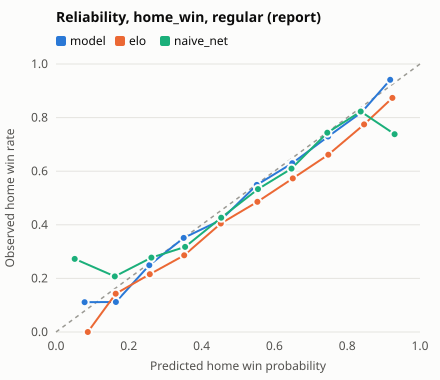
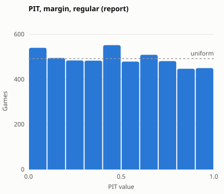
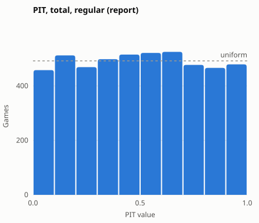

# Evaluation 2021-22 to 2024-25

## Run: report availability

- **Seasons:** 2021-22 to 2024-25; weekly refits, frozen config
- **Availability at test time:** `report`; training, calibration and sigma use who actually played
- **CIs:** 95% percentile bootstrap over games (1000 replicates); `vs Elo` is the paired difference (negative is better, except accuracy). ECE is biased upward under resampling, so its interval can sit above the estimate

### Where the model does not beat Elo

| target | scope | metric | model | elo | diff | diff_lo | diff_hi | verdict |
|---|---|---|---|---|---|---|---|---|
| home_win | play_in | ece | 0.0706 | 0.0660 | 0.0046 | -0.0858 | 0.1409 | worse |
| margin | play_in | mae | 11.5903 | 10.6523 | 0.9380 | -0.3368 | 2.3321 | worse |
| margin | play_in | rmse | 13.9945 | 13.2013 | 0.7932 | -0.4015 | 2.1505 | worse |
| margin | playoffs | mae | 12.5636 | 12.0524 | 0.5112 | -0.0379 | 1.0847 | worse |
| margin | playoffs | rmse | 15.8550 | 15.2553 | 0.5997 | 0.0274 | 1.2303 | worse |
| margin | postseason | mae | 12.4989 | 11.9593 | 0.5396 | 0.0182 | 1.1044 | worse |
| margin | postseason | rmse | 15.7382 | 15.1274 | 0.6107 | 0.0090 | 1.2262 | worse |
| total | preseason | mae | 14.3294 | 14.2862 | 0.0431 | -0.7945 | 0.8693 | worse |
| total | preseason | rmse | 18.6438 | 18.0973 | 0.5465 | -0.5432 | 1.6206 | worse |
| home_win | preseason | accuracy | 0.5745 | 0.5709 | 0.0035 | -0.0355 | 0.0461 | not significantly better |
| home_win | play_in | log_loss | 0.6447 | 0.6515 | -0.0067 | -0.0579 | 0.0421 | not significantly better |
| home_win | play_in | brier | 0.2269 | 0.2298 | -0.0029 | -0.0267 | 0.0191 | not significantly better |
| home_win | play_in | accuracy | 0.6667 | 0.6250 | 0.0417 | -0.0833 | 0.1667 | not significantly better |
| home_win | playoffs | log_loss | 0.6539 | 0.6576 | -0.0037 | -0.0139 | 0.0058 | not significantly better |
| home_win | playoffs | brier | 0.2300 | 0.2318 | -0.0018 | -0.0068 | 0.0026 | not significantly better |
| home_win | playoffs | accuracy | 0.6350 | 0.6083 | 0.0267 | -0.0030 | 0.0593 | not significantly better |
| home_win | playoffs | ece | 0.0450 | 0.0763 | -0.0313 | -0.0674 | 0.0163 | not significantly better |
| home_win | postseason | log_loss | 0.6533 | 0.6572 | -0.0039 | -0.0139 | 0.0060 | not significantly better |
| home_win | postseason | brier | 0.2298 | 0.2317 | -0.0019 | -0.0066 | 0.0028 | not significantly better |
| home_win | postseason | accuracy | 0.6371 | 0.6094 | 0.0277 | -0.0028 | 0.0609 | not significantly better |
| home_win | postseason | ece | 0.0397 | 0.0701 | -0.0304 | -0.0643 | 0.0183 | not significantly better |

## home_win (report availability)

**regular** (4920 games)

| model | log_loss | log_loss vs Elo | brier | brier vs Elo | accuracy | accuracy vs Elo | ece | ece vs Elo |
|---|---|---|---|---|---|---|---|---|
| model | 0.6131 [0.6028, 0.6238] | -0.0244 [-0.0301, -0.0193] | 0.2126 [0.2079, 0.2174] | -0.0104 [-0.0128, -0.0082] | 0.6652 [0.6518, 0.6787] | 0.0230 [0.0130, 0.0331] | 0.0166 [0.0125, 0.0328] | -0.0529 [-0.0545, -0.0364] |
| elo | 0.6375 [0.6260, 0.6497] | ref | 0.2229 [0.2179, 0.2282] | ref | 0.6423 [0.6291, 0.6547] | ref | 0.0695 [0.0574, 0.0819] | ref |
| naive_home | 0.6880 [0.6846, 0.6914] | 0.0504 [0.0395, 0.0610] | 0.2474 [0.2457, 0.2491] | 0.0245 [0.0199, 0.0290] | 0.5528 [0.5394, 0.5671] | -0.0894 [-0.1026, -0.0756] | 0.0070 [0.0003, 0.0203] | -0.0625 [-0.0679, -0.0507] |
| naive_net | 0.6415 [0.6309, 0.6520] | 0.0039 [-0.0033, 0.0111] | 0.2240 [0.2195, 0.2284] | 0.0011 [-0.0017, 0.0037] | 0.6350 [0.6221, 0.6486] | -0.0073 [-0.0167, 0.0022] | 0.0259 [0.0183, 0.0412] | -0.0436 [-0.0465, -0.0312] |

**preseason** (282 games)

| model | log_loss | log_loss vs Elo | brier | brier vs Elo | accuracy | accuracy vs Elo | ece | ece vs Elo |
|---|---|---|---|---|---|---|---|---|
| model | 0.6771 [0.6419, 0.7160] | -0.0445 [-0.0693, -0.0210] | 0.2425 [0.2265, 0.2597] | -0.0166 [-0.0267, -0.0072] | 0.5745 [0.5177, 0.6312] | 0.0035 [-0.0355, 0.0461] | 0.0913 [0.0551, 0.1489] | -0.0394 [-0.0787, -0.0007] |
| elo | 0.7215 [0.6730, 0.7760] | ref | 0.2591 [0.2379, 0.2835] | ref | 0.5709 [0.5106, 0.6241] | ref | 0.1307 [0.0903, 0.1910] | ref |
| naive_home | 0.6776 [0.6647, 0.6917] | -0.0439 [-0.0908, -0.0000] | 0.2423 [0.2358, 0.2493] | -0.0169 [-0.0363, 0.0015] | 0.5957 [0.5354, 0.6526] | 0.0248 [-0.0248, 0.0780] | 0.0411 [0.0030, 0.0988] | -0.0896 [-0.1687, -0.0193] |
| naive_net | 0.6748 [0.6543, 0.6964] | -0.0467 [-0.0906, -0.0051] | 0.2409 [0.2307, 0.2516] | -0.0183 [-0.0363, -0.0009] | 0.5957 [0.5354, 0.6526] | 0.0248 [-0.0248, 0.0780] | 0.0090 [0.0016, 0.0694] | -0.1217 [-0.1752, -0.0497] |

**play_in** (24 games)

| model | log_loss | log_loss vs Elo | brier | brier vs Elo | accuracy | accuracy vs Elo | ece | ece vs Elo |
|---|---|---|---|---|---|---|---|---|
| model | 0.6447 [0.5337, 0.7582] | -0.0067 [-0.0579, 0.0421] | 0.2269 [0.1742, 0.2806] | -0.0029 [-0.0267, 0.0191] | 0.6667 [0.4583, 0.8333] | 0.0417 [-0.0833, 0.1667] | 0.0706 [0.0595, 0.2890] | 0.0046 [-0.0858, 0.1409] |
| elo | 0.6515 [0.5220, 0.7876] | ref | 0.2298 [0.1688, 0.2945] | ref | 0.6250 [0.4167, 0.7917] | ref | 0.0660 [0.0395, 0.2762] | ref |
| naive_home | 0.6771 [0.6349, 0.7213] | 0.0256 [-0.0687, 0.1174] | 0.2420 [0.2210, 0.2640] | 0.0122 [-0.0321, 0.0547] | 0.6250 [0.4167, 0.7917] | 0.0000 [0.0000, 0.0000] | 0.0703 [0.0116, 0.2409] | 0.0042 [-0.1989, 0.1137] |
| naive_net | 0.6585 [0.5775, 0.7438] | 0.0071 [-0.0606, 0.0750] | 0.2330 [0.1935, 0.2746] | 0.0032 [-0.0283, 0.0353] | 0.6250 [0.4167, 0.7917] | 0.0000 [0.0000, 0.0000] | 0.0290 [0.0202, 0.2470] | -0.0371 [-0.1640, 0.1145] |

**playoffs** (337 games)

| model | log_loss | log_loss vs Elo | brier | brier vs Elo | accuracy | accuracy vs Elo | ece | ece vs Elo |
|---|---|---|---|---|---|---|---|---|
| model | 0.6539 [0.6190, 0.6948] | -0.0037 [-0.0139, 0.0058] | 0.2300 [0.2147, 0.2483] | -0.0018 [-0.0068, 0.0026] | 0.6350 [0.5816, 0.6855] | 0.0267 [-0.0030, 0.0593] | 0.0450 [0.0327, 0.1035] | -0.0313 [-0.0674, 0.0163] |
| elo | 0.6576 [0.6220, 0.6975] | ref | 0.2318 [0.2157, 0.2503] | ref | 0.6083 [0.5549, 0.6558] | ref | 0.0763 [0.0497, 0.1358] | ref |
| naive_home | 0.6804 [0.6692, 0.6928] | 0.0228 [-0.0097, 0.0516] | 0.2437 [0.2381, 0.2498] | 0.0118 [-0.0023, 0.0243] | 0.5875 [0.5341, 0.6380] | -0.0208 [-0.0564, 0.0178] | 0.0319 [0.0016, 0.0816] | -0.0444 [-0.1124, 0.0195] |
| naive_net | 0.6518 [0.6239, 0.6823] | -0.0058 [-0.0233, 0.0103] | 0.2297 [0.2167, 0.2441] | -0.0021 [-0.0101, 0.0051] | 0.6380 [0.5846, 0.6855] | 0.0297 [-0.0030, 0.0623] | 0.0498 [0.0282, 0.1064] | -0.0265 [-0.0796, 0.0317] |

**postseason** (361 games)

| model | log_loss | log_loss vs Elo | brier | brier vs Elo | accuracy | accuracy vs Elo | ece | ece vs Elo |
|---|---|---|---|---|---|---|---|---|
| model | 0.6533 [0.6183, 0.6920] | -0.0039 [-0.0139, 0.0060] | 0.2298 [0.2143, 0.2473] | -0.0019 [-0.0066, 0.0028] | 0.6371 [0.5845, 0.6814] | 0.0277 [-0.0028, 0.0609] | 0.0397 [0.0291, 0.1011] | -0.0304 [-0.0643, 0.0183] |
| elo | 0.6572 [0.6220, 0.6954] | ref | 0.2317 [0.2156, 0.2494] | ref | 0.6094 [0.5540, 0.6566] | ref | 0.0701 [0.0439, 0.1255] | ref |
| naive_home | 0.6802 [0.6686, 0.6922] | 0.0230 [-0.0064, 0.0515] | 0.2435 [0.2378, 0.2495] | 0.0119 [-0.0012, 0.0243] | 0.5900 [0.5374, 0.6399] | -0.0194 [-0.0526, 0.0139] | 0.0344 [0.0015, 0.0836] | -0.0357 [-0.1085, 0.0235] |
| naive_net | 0.6522 [0.6261, 0.6801] | -0.0050 [-0.0219, 0.0102] | 0.2300 [0.2177, 0.2432] | -0.0017 [-0.0093, 0.0051] | 0.6371 [0.5872, 0.6842] | 0.0277 [-0.0028, 0.0582] | 0.0481 [0.0255, 0.1038] | -0.0220 [-0.0783, 0.0329] |

**log_loss by season (regular season)**

| season | model | elo | naive_home | naive_net | games |
|---|---|---|---|---|---|
| 2021-22 | 0.6216 | 0.6493 | 0.6899 | 0.6619 | 1230 |
| 2022-23 | 0.6361 | 0.6538 | 0.6823 | 0.6547 | 1230 |
| 2023-24 | 0.5994 | 0.6243 | 0.6904 | 0.6286 | 1230 |
| 2024-25 | 0.5955 | 0.6228 | 0.6893 | 0.6206 | 1230 |

## margin (report availability)

**regular** (4920 games)

| model | mae | mae vs Elo | rmse | rmse vs Elo | coverage_80 | coverage_80 vs Elo |
|---|---|---|---|---|---|---|
| model | 10.79 [10.55, 11.01] | -0.1565 [-0.2460, -0.0708] | 13.77 [13.47, 14.06] | -0.2059 [-0.3076, -0.1045] | 0.7988 [0.7878, 0.8102] | -0.0069 [-0.0144, 0.0000] |
| elo | 10.94 [10.70, 11.18] | ref | 13.98 [13.67, 14.28] | ref | 0.8057 [0.7953, 0.8171] | ref |
| naive_home | 12.05 [11.79, 12.30] | 1.1023 [0.9592, 1.2436] | 15.16 [14.82, 15.47] | 1.1792 [1.0245, 1.3244] | 0.8083 [0.7976, 0.8193] | 0.0026 [-0.0065, 0.0114] |
| naive_net | 11.14 [10.90, 11.39] | 0.1917 [0.1115, 0.2699] | 14.18 [13.87, 14.48] | 0.1998 [0.1180, 0.2895] | 0.8083 [0.7982, 0.8189] | 0.0026 [-0.0035, 0.0089] |

**preseason** (282 games)

| model | mae | mae vs Elo | rmse | rmse vs Elo | coverage_80 | coverage_80 vs Elo |
|---|---|---|---|---|---|---|
| model | 12.51 [11.28, 13.76] | -1.1120 [-1.7351, -0.5463] | 16.64 [14.92, 18.47] | -1.4027 [-2.3116, -0.6060] | 0.8262 [0.7801, 0.8688] | 0.0177 [-0.0071, 0.0461] |
| elo | 13.62 [12.27, 14.99] | ref | 18.04 [16.11, 19.82] | ref | 0.8085 [0.7624, 0.8546] | ref |
| naive_home | 13.23 [11.85, 14.60] | -0.3883 [-0.9081, 0.1172] | 17.94 [15.98, 19.82] | -0.1072 [-0.5839, 0.3849] | 0.8191 [0.7766, 0.8652] | 0.0106 [-0.0106, 0.0319] |
| naive_net | 13.21 [11.83, 14.57] | -0.4077 [-0.9072, 0.0734] | 17.87 [15.93, 19.73] | -0.1711 [-0.6326, 0.3028] | 0.8191 [0.7766, 0.8652] | 0.0106 [-0.0106, 0.0319] |

**play_in** (24 games)

| model | mae | mae vs Elo | rmse | rmse vs Elo | coverage_80 | coverage_80 vs Elo |
|---|---|---|---|---|---|---|
| model | 11.59 [8.3595, 14.76] | 0.9380 [-0.3368, 2.3321] | 13.99 [10.81, 16.59] | 0.7932 [-0.4015, 2.1505] | 0.7500 [0.5833, 0.9167] | 0.0000 [-0.1250, 0.1250] |
| elo | 10.65 [7.7209, 13.75] | ref | 13.20 [9.9792, 16.07] | ref | 0.7500 [0.5833, 0.9167] | ref |
| naive_home | 11.30 [8.4403, 14.28] | 0.6506 [-0.3204, 1.6238] | 13.50 [10.38, 16.26] | 0.2956 [-0.7303, 1.3088] | 0.7500 [0.5833, 0.9167] | 0.0000 [-0.1250, 0.1250] |
| naive_net | 11.06 [8.3096, 13.85] | 0.4064 [-0.2695, 1.0836] | 13.19 [10.18, 15.83] | -0.0098 [-0.7830, 0.7304] | 0.7917 [0.6250, 0.9583] | 0.0417 [0.0000, 0.1250] |

**playoffs** (337 games)

| model | mae | mae vs Elo | rmse | rmse vs Elo | coverage_80 | coverage_80 vs Elo |
|---|---|---|---|---|---|---|
| model | 12.56 [11.46, 13.63] | 0.5112 [-0.0379, 1.0847] | 15.86 [14.50, 17.10] | 0.5997 [0.0274, 1.2303] | 0.7656 [0.7211, 0.8101] | -0.0059 [-0.0415, 0.0267] |
| elo | 12.05 [11.03, 13.00] | ref | 15.26 [13.93, 16.46] | ref | 0.7715 [0.7300, 0.8190] | ref |
| naive_home | 12.61 [11.57, 13.65] | 0.5592 [0.1999, 0.9132] | 15.85 [14.50, 17.13] | 0.5903 [0.2107, 0.9616] | 0.7893 [0.7478, 0.8339] | 0.0178 [-0.0059, 0.0416] |
| naive_net | 12.00 [10.99, 13.02] | -0.0560 [-0.2552, 0.1389] | 15.30 [13.92, 16.55] | 0.0421 [-0.1443, 0.2341] | 0.7745 [0.7300, 0.8190] | 0.0030 [-0.0208, 0.0267] |

**postseason** (361 games)

| model | mae | mae vs Elo | rmse | rmse vs Elo | coverage_80 | coverage_80 vs Elo |
|---|---|---|---|---|---|---|
| model | 12.50 [11.53, 13.42] | 0.5396 [0.0182, 1.1044] | 15.74 [14.58, 16.93] | 0.6107 [0.0090, 1.2262] | 0.7645 [0.7202, 0.8061] | -0.0055 [-0.0416, 0.0249] |
| elo | 11.96 [11.00, 12.94] | ref | 15.13 [13.95, 16.28] | ref | 0.7701 [0.7285, 0.8172] | ref |
| naive_home | 12.52 [11.55, 13.51] | 0.5653 [0.2396, 0.9066] | 15.70 [14.50, 16.91] | 0.5730 [0.2092, 0.9158] | 0.7867 [0.7424, 0.8310] | 0.0166 [-0.0083, 0.0416] |
| naive_net | 11.93 [11.01, 12.93] | -0.0252 [-0.2151, 0.1576] | 15.17 [13.96, 16.38] | 0.0391 [-0.1425, 0.2195] | 0.7756 [0.7313, 0.8199] | 0.0055 [-0.0139, 0.0249] |

**mae by season (regular season)**

| season | model | elo | naive_home | naive_net | games |
|---|---|---|---|---|---|
| 2021-22 | 11.0610 | 11.2487 | 12.2363 | 11.5209 | 1230 |
| 2022-23 | 10.1914 | 10.2163 | 10.8978 | 10.3542 | 1230 |
| 2023-24 | 10.9468 | 11.1599 | 12.4478 | 11.3492 | 1230 |
| 2024-25 | 10.9509 | 11.1513 | 12.6036 | 11.3189 | 1230 |

## total (report availability)

**regular** (4920 games)

| model | mae | mae vs Elo | rmse | rmse vs Elo | coverage_80 | coverage_80 vs Elo |
|---|---|---|---|---|---|---|
| model | 14.60 [14.31, 14.91] | -1.1006 [-1.2790, -0.9262] | 18.40 [18.01, 18.78] | -1.3945 [-1.5785, -1.2127] | 0.8096 [0.7982, 0.8203] | 0.0061 [-0.0022, 0.0146] |
| elo | 15.71 [15.38, 16.06] | ref | 19.79 [19.37, 20.21] | ref | 0.8035 [0.7923, 0.8142] | ref |
| naive_home | 15.92 [15.59, 16.27] | 0.2173 [0.1501, 0.2812] | 20.06 [19.63, 20.49] | 0.2689 [0.2001, 0.3275] | 0.8114 [0.8004, 0.8218] | 0.0079 [0.0028, 0.0130] |
| naive_net | 15.00 [14.68, 15.31] | -0.7038 [-0.8409, -0.5629] | 18.92 [18.52, 19.31] | -0.8704 [-1.0105, -0.7183] | 0.8073 [0.7967, 0.8179] | 0.0039 [-0.0039, 0.0116] |

**preseason** (282 games)

| model | mae | mae vs Elo | rmse | rmse vs Elo | coverage_80 | coverage_80 vs Elo |
|---|---|---|---|---|---|---|
| model | 14.33 [12.92, 15.68] | 0.0431 [-0.7945, 0.8693] | 18.64 [16.74, 20.31] | 0.5465 [-0.5432, 1.6206] | 0.8156 [0.7695, 0.8617] | -0.0177 [-0.0496, 0.0177] |
| elo | 14.29 [12.96, 15.47] | ref | 18.10 [16.46, 19.65] | ref | 0.8333 [0.7942, 0.8759] | ref |
| naive_home | 14.55 [13.23, 15.78] | 0.2653 [-0.0610, 0.6145] | 18.39 [16.77, 19.91] | 0.2967 [-0.0429, 0.6588] | 0.8050 [0.7589, 0.8511] | -0.0284 [-0.0567, 0.0000] |
| naive_net | 15.00 [13.69, 16.22] | 0.7151 [0.4359, 1.0118] | 18.87 [17.23, 20.41] | 0.7690 [0.4919, 1.0400] | 0.8369 [0.7943, 0.8759] | 0.0035 [-0.0177, 0.0248] |

**play_in** (24 games)

| model | mae | mae vs Elo | rmse | rmse vs Elo | coverage_80 | coverage_80 vs Elo |
|---|---|---|---|---|---|---|
| model | 11.87 [8.7811, 14.91] | -2.9843 [-5.6145, -0.5843] | 14.07 [10.80, 16.87] | -2.9316 [-5.6726, -0.3944] | 0.9583 [0.8750, 1.0000] | 0.0417 [0.0000, 0.1250] |
| elo | 14.86 [11.56, 18.19] | ref | 17.00 [13.25, 20.41] | ref | 0.9167 [0.7917, 1.0000] | ref |
| naive_home | 14.27 [10.90, 17.59] | -0.5934 [-1.8249, 0.6178] | 16.58 [12.68, 20.00] | -0.4271 [-1.5791, 0.7632] | 0.9167 [0.7917, 1.0000] | 0.0000 [0.0000, 0.0000] |
| naive_net | 14.08 [11.05, 17.14] | -0.7781 [-2.4322, 0.8269] | 16.12 [12.63, 19.01] | -0.8826 [-2.6253, 0.8687] | 0.8750 [0.7500, 1.0000] | -0.0417 [-0.1250, 0.0000] |

**playoffs** (337 games)

| model | mae | mae vs Elo | rmse | rmse vs Elo | coverage_80 | coverage_80 vs Elo |
|---|---|---|---|---|---|---|
| model | 14.92 [13.63, 16.03] | -2.7274 [-3.7609, -1.7911] | 18.76 [17.31, 20.06] | -2.8776 [-3.8473, -1.9696] | 0.8101 [0.7715, 0.8517] | 0.0267 [-0.0119, 0.0653] |
| elo | 17.65 [16.26, 18.96] | ref | 21.64 [20.10, 23.07] | ref | 0.7834 [0.7418, 0.8309] | ref |
| naive_home | 18.00 [16.58, 19.34] | 0.3520 [0.0312, 0.6962] | 21.98 [20.38, 23.42] | 0.3346 [0.0371, 0.6554] | 0.7715 [0.7240, 0.8160] | -0.0119 [-0.0386, 0.0119] |
| naive_net | 17.67 [16.31, 18.96] | 0.0251 [-0.5509, 0.6285] | 21.41 [19.97, 22.72] | -0.2272 [-0.8136, 0.3610] | 0.7656 [0.7181, 0.8131] | -0.0178 [-0.0476, 0.0119] |

**postseason** (361 games)

| model | mae | mae vs Elo | rmse | rmse vs Elo | coverage_80 | coverage_80 vs Elo |
|---|---|---|---|---|---|---|
| model | 14.72 [13.55, 15.89] | -2.7445 [-3.6836, -1.8353] | 18.49 [17.20, 19.85] | -2.8754 [-3.8685, -1.9451] | 0.8199 [0.7784, 0.8587] | 0.0277 [-0.0111, 0.0666] |
| elo | 17.46 [16.28, 18.77] | ref | 21.36 [20.07, 22.82] | ref | 0.7922 [0.7479, 0.8338] | ref |
| naive_home | 17.75 [16.56, 19.05] | 0.2892 [-0.0541, 0.5992] | 21.66 [20.41, 23.05] | 0.2945 [-0.0254, 0.6115] | 0.7812 [0.7341, 0.8227] | -0.0111 [-0.0360, 0.0139] |
| naive_net | 17.43 [16.24, 18.74] | -0.0283 [-0.5907, 0.5128] | 21.10 [19.82, 22.50] | -0.2608 [-0.8331, 0.2800] | 0.7729 [0.7258, 0.8116] | -0.0194 [-0.0499, 0.0111] |

**mae by season (regular season)**

| season | model | elo | naive_home | naive_net | games |
|---|---|---|---|---|---|
| 2021-22 | 14.7210 | 15.6466 | 16.1276 | 15.1305 | 1230 |
| 2022-23 | 14.4810 | 15.2192 | 15.4490 | 14.6366 | 1230 |
| 2023-24 | 14.7016 | 16.0721 | 16.1548 | 15.2867 | 1230 |
| 2024-25 | 14.5155 | 15.8838 | 15.9595 | 14.9529 | 1230 |

### Calibration (report availability)

### Drivers (report availability)

- Mean absolute contribution per family, regular season (log-odds for `home_win`, points otherwise)

| target | rung | elo | form | rest_travel | availability | home_court | game_type | league |
|---|---|---|---|---|---|---|---|---|
| home_win | linear | 0.3950 | 0.2020 | 0.0850 | 0.2170 | 0.0020 | 0.0050 | 0.0240 |
| margin | lgbm | 2.8610 | 1.8060 | 0.3590 | 1.8710 | 0.0110 | 0.0060 | 0.1120 |
| total | linear | 0.3400 | 19.1480 | 0.6060 | 1.1480 | 0.0640 | 0.6310 | 5.8610 |

- Check: base + contributions = raw output for every prediction

| target | n | max_gap | max_pred_gap |
|---|---|---|---|
| home_win | 5565 | 0.0000 | 0.0000 |
| margin | 5565 | 0.0000 | 0 |
| total | 5565 | 0.0000 | 0 |

## Availability era shift (issue #7)

| season | team_games | full_strength | lost_actual | lost_report | report_share |
|---|---|---|---|---|---|
| 2012-13 | 2428 | 84.3520 | 10.8240 | 0 | 0 |
| 2013-14 | 2430 | 85.9720 | 11.4230 | 0 | 0 |
| 2014-15 | 2430 | 87.1210 | 13 | 0 | 0 |
| 2015-16 | 2430 | 87.6630 | 11.8440 | 0 | 0 |
| 2016-17 | 2430 | 93.1640 | 13.5560 | 0 | 0 |
| 2017-18 | 2430 | 95.2350 | 15.3840 | 0 | 0 |
| 2018-19 | 2430 | 100.0740 | 16.1980 | 0 | 0 |
| 2019-20 | 2088 | 101.9920 | 18.2550 | 0 | 0 |
| 2020-21 | 2130 | 107.5380 | 22.2400 | 0 | 0 |
| 2021-22 | 2430 | 119.8270 | 36.2010 | 30.4490 | 0.8410 |
| 2022-23 | 2430 | 119.0970 | 30.7330 | 25.0980 | 0.8170 |
| 2023-24 | 2430 | 122.1530 | 31.5140 | 26.5120 | 0.8410 |
| 2024-25 | 2430 | 124.8430 | 35.7140 | 30.2200 | 0.8460 |

