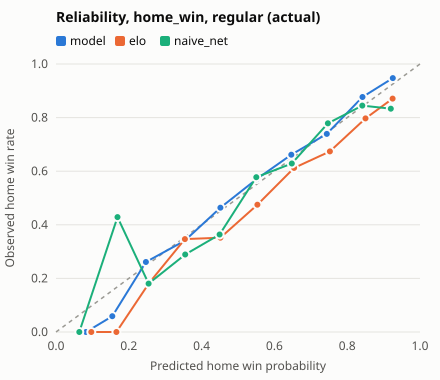
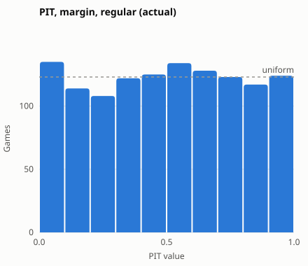
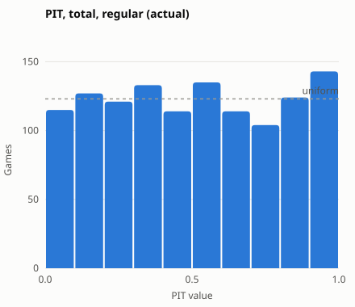
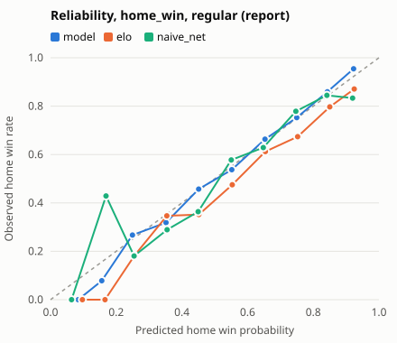
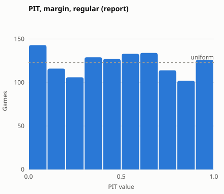
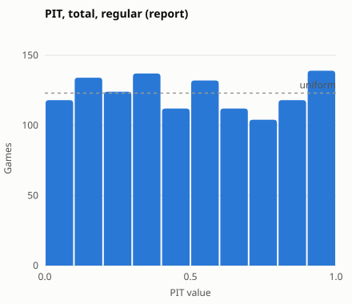

# Evaluation 2025-26 to 2025-26 (holdout)

## Run: actual availability

- **Seasons:** 2025-26 to 2025-26; weekly refits, frozen config
- **Availability at test time:** `actual`; training, calibration and sigma use who actually played
- **CIs:** 95% percentile bootstrap over games (1000 replicates); `vs Elo` is the paired difference (negative is better, except accuracy). ECE is biased upward under resampling, so its interval can sit above the estimate

### Where the model does not beat Elo

| target | scope | metric | model | elo | diff | diff_lo | diff_hi | verdict |
|---|---|---|---|---|---|---|---|---|
| home_win | play_in | log_loss | 0.7494 | 0.7362 | 0.0132 | -0.1453 | 0.1394 | worse |
| home_win | play_in | brier | 0.2749 | 0.2683 | 0.0066 | -0.0684 | 0.0680 | worse |
| home_win | play_in | accuracy | 0.3333 | 0.5000 | -0.1667 | -0.5000 | 0 | worse |
| home_win | play_in | ece | 0.3226 | 0.1946 | 0.1280 | -0.0599 | 0.2771 | worse |
| home_win | playoffs | accuracy | 0.6235 | 0.6941 | -0.0706 | -0.1294 | -0.0118 | worse |
| home_win | postseason | accuracy | 0.6044 | 0.6813 | -0.0769 | -0.1429 | -0.0110 | worse |
| margin | play_in | mae | 13.2502 | 12.8167 | 0.4335 | -1.6716 | 2.6980 | worse |
| margin | play_in | rmse | 15.8966 | 15.4769 | 0.4197 | -1.0262 | 2.8498 | worse |
| total | preseason | rmse | 21.6946 | 20.9809 | 0.7137 | -0.7966 | 2.2089 | worse |
| home_win | regular | accuracy | 0.6911 | 0.6732 | 0.0179 | -0.0024 | 0.0398 | not significantly better |
| home_win | regular | ece | 0.0198 | 0.0651 | -0.0454 | -0.0646 | 0.0013 | not significantly better |
| home_win | preseason | accuracy | 0.5915 | 0.5493 | 0.0423 | -0.0282 | 0.1127 | not significantly better |
| home_win | preseason | ece | 0.1092 | 0.1540 | -0.0448 | -0.1104 | 0.0329 | not significantly better |
| home_win | playoffs | log_loss | 0.6534 | 0.6582 | -0.0048 | -0.0336 | 0.0228 | not significantly better |
| home_win | playoffs | brier | 0.2279 | 0.2302 | -0.0022 | -0.0160 | 0.0111 | not significantly better |
| home_win | playoffs | ece | 0.1232 | 0.1697 | -0.0465 | -0.1218 | 0.0693 | not significantly better |
| home_win | postseason | log_loss | 0.6597 | 0.6634 | -0.0036 | -0.0298 | 0.0208 | not significantly better |
| home_win | postseason | brier | 0.2310 | 0.2327 | -0.0017 | -0.0140 | 0.0093 | not significantly better |
| home_win | postseason | ece | 0.1304 | 0.1597 | -0.0294 | -0.0993 | 0.0826 | not significantly better |
| margin | playoffs | mae | 12.6628 | 12.8241 | -0.1613 | -0.7570 | 0.4456 | not significantly better |
| margin | playoffs | rmse | 15.9186 | 16.0793 | -0.1607 | -0.8675 | 0.5347 | not significantly better |
| margin | postseason | mae | 12.7015 | 12.8236 | -0.1221 | -0.7131 | 0.4137 | not significantly better |
| margin | postseason | rmse | 15.9172 | 16.0402 | -0.1231 | -0.7236 | 0.5059 | not significantly better |
| total | preseason | mae | 17.0686 | 17.1495 | -0.0809 | -1.6435 | 1.5711 | not significantly better |
| total | play_in | mae | 17.5181 | 19.2429 | -1.7248 | -7.7722 | 4.4264 | not significantly better |
| total | play_in | rmse | 19.0355 | 20.2057 | -1.1701 | -7.6002 | 5.0383 | not significantly better |

## home_win (actual availability)

**regular** (1230 games)

| model | log_loss | log_loss vs Elo | brier | brier vs Elo | accuracy | accuracy vs Elo | ece | ece vs Elo |
|---|---|---|---|---|---|---|---|---|
| model | 0.5803 [0.5587, 0.6033] | -0.0280 [-0.0411, -0.0163] | 0.1988 [0.1895, 0.2090] | -0.0105 [-0.0162, -0.0057] | 0.6911 [0.6667, 0.7171] | 0.0179 [-0.0024, 0.0398] | 0.0198 [0.0200, 0.0531] | -0.0454 [-0.0646, 0.0013] |
| elo | 0.6083 [0.5827, 0.6349] | ref | 0.2093 [0.1988, 0.2206] | ref | 0.6732 [0.6463, 0.6992] | ref | 0.0651 [0.0461, 0.0938] | ref |
| naive_home | 0.6877 [0.6826, 0.6929] | 0.0793 [0.0545, 0.1021] | 0.2473 [0.2447, 0.2499] | 0.0379 [0.0278, 0.0473] | 0.5545 [0.5252, 0.5829] | -0.1187 [-0.1480, -0.0902] | 0.0103 [0.0005, 0.0386] | -0.0548 [-0.0821, -0.0091] |
| naive_net | 0.6054 [0.5855, 0.6273] | -0.0029 [-0.0173, 0.0112] | 0.2081 [0.1994, 0.2178] | -0.0012 [-0.0069, 0.0045] | 0.6870 [0.6593, 0.7130] | 0.0138 [-0.0057, 0.0341] | 0.0455 [0.0325, 0.0734] | -0.0196 [-0.0440, 0.0169] |

**preseason** (71 games)

| model | log_loss | log_loss vs Elo | brier | brier vs Elo | accuracy | accuracy vs Elo | ece | ece vs Elo |
|---|---|---|---|---|---|---|---|---|
| model | 0.6367 [0.5608, 0.7132] | -0.0884 [-0.1486, -0.0370] | 0.2250 [0.1900, 0.2598] | -0.0376 [-0.0640, -0.0160] | 0.5915 [0.4789, 0.7042] | 0.0423 [-0.0282, 0.1127] | 0.1092 [0.0810, 0.2384] | -0.0448 [-0.1104, 0.0329] |
| elo | 0.7252 [0.6164, 0.8373] | ref | 0.2626 [0.2165, 0.3095] | ref | 0.5493 [0.4366, 0.6620] | ref | 0.1540 [0.1023, 0.2859] | ref |
| naive_home | 0.6920 [0.6697, 0.7152] | -0.0332 [-0.1382, 0.0722] | 0.2494 [0.2383, 0.2610] | -0.0132 [-0.0569, 0.0320] | 0.5352 [0.4085, 0.6479] | -0.0141 [-0.1549, 0.1268] | 0.0117 [0.0022, 0.1391] | -0.1423 [-0.2459, -0.0449] |
| naive_net | 0.6951 [0.6579, 0.7370] | -0.0300 [-0.1306, 0.0764] | 0.2510 [0.2325, 0.2717] | -0.0116 [-0.0541, 0.0335] | 0.5352 [0.4085, 0.6479] | -0.0141 [-0.1549, 0.1268] | 0.0466 [0.0044, 0.1734] | -0.1073 [-0.2290, -0.0374] |

**play_in** (6 games)

| model | log_loss | log_loss vs Elo | brier | brier vs Elo | accuracy | accuracy vs Elo | ece | ece vs Elo |
|---|---|---|---|---|---|---|---|---|
| model | 0.7494 [0.4447, 1.0669] | 0.0132 [-0.1453, 0.1394] | 0.2749 [0.1359, 0.4156] | 0.0066 [-0.0684, 0.0680] | 0.3333 [0.0000, 0.8333] | -0.1667 [-0.5000, 0.0000] | 0.3226 [0.1318, 0.6258] | 0.1280 [-0.0599, 0.2771] |
| elo | 0.7362 [0.3317, 1.1260] | ref | 0.2683 [0.0868, 0.4421] | ref | 0.5000 [0.1667, 1.0000] | ref | 0.1946 [0.0724, 0.5823] | ref |
| naive_home | 0.6627 [0.5927, 0.7327] | -0.0735 [-0.3788, 0.2609] | 0.2348 [0.1999, 0.2697] | -0.0335 [-0.1689, 0.1132] | 0.6667 [0.3333, 1.0000] | 0.1667 [0.0000, 0.5000] | 0.1146 [0.0512, 0.4480] | -0.0800 [-0.4614, 0.1776] |
| naive_net | 0.6919 [0.5080, 0.8586] | -0.0443 [-0.2599, 0.1610] | 0.2494 [0.1595, 0.3311] | -0.0189 [-0.1085, 0.0658] | 0.5000 [0.1667, 1.0000] | 0.0000 [0.0000, 0.0000] | 0.2433 [0.0462, 0.5569] | 0.0486 [-0.2222, 0.2037] |

**playoffs** (85 games)

| model | log_loss | log_loss vs Elo | brier | brier vs Elo | accuracy | accuracy vs Elo | ece | ece vs Elo |
|---|---|---|---|---|---|---|---|---|
| model | 0.6534 [0.5724, 0.7458] | -0.0048 [-0.0336, 0.0228] | 0.2279 [0.1927, 0.2684] | -0.0022 [-0.0160, 0.0111] | 0.6235 [0.5176, 0.7176] | -0.0706 [-0.1294, -0.0118] | 0.1232 [0.0881, 0.2396] | -0.0465 [-0.1218, 0.0693] |
| elo | 0.6582 [0.5733, 0.7507] | ref | 0.2302 [0.1924, 0.2698] | ref | 0.6941 [0.5882, 0.7882] | ref | 0.1697 [0.1079, 0.2758] | ref |
| naive_home | 0.6877 [0.6641, 0.7116] | 0.0295 [-0.0510, 0.1027] | 0.2473 [0.2355, 0.2592] | 0.0171 [-0.0170, 0.0483] | 0.5529 [0.4471, 0.6588] | -0.1412 [-0.2353, -0.0471] | 0.0031 [0.0030, 0.1208] | -0.1666 [-0.2323, -0.0381] |
| naive_net | 0.6412 [0.5820, 0.7038] | -0.0170 [-0.0553, 0.0199] | 0.2245 [0.1970, 0.2537] | -0.0057 [-0.0214, 0.0093] | 0.6706 [0.5765, 0.7765] | -0.0235 [-0.0941, 0.0471] | 0.0619 [0.0597, 0.1943] | -0.1079 [-0.1577, 0.0250] |

**postseason** (91 games)

| model | log_loss | log_loss vs Elo | brier | brier vs Elo | accuracy | accuracy vs Elo | ece | ece vs Elo |
|---|---|---|---|---|---|---|---|---|
| model | 0.6597 [0.5748, 0.7518] | -0.0036 [-0.0298, 0.0208] | 0.2310 [0.1935, 0.2717] | -0.0017 [-0.0140, 0.0093] | 0.6044 [0.4945, 0.7033] | -0.0769 [-0.1429, -0.0110] | 0.1304 [0.0947, 0.2383] | -0.0294 [-0.0993, 0.0826] |
| elo | 0.6634 [0.5774, 0.7572] | ref | 0.2327 [0.1951, 0.2738] | ref | 0.6813 [0.5824, 0.7802] | ref | 0.1597 [0.1069, 0.2637] | ref |
| naive_home | 0.6861 [0.6659, 0.7083] | 0.0227 [-0.0581, 0.0972] | 0.2465 [0.2364, 0.2575] | 0.0138 [-0.0209, 0.0462] | 0.5604 [0.4615, 0.6484] | -0.1209 [-0.2198, -0.0330] | 0.0047 [0.0046, 0.1144] | -0.1551 [-0.2258, -0.0380] |
| naive_net | 0.6445 [0.5843, 0.7126] | -0.0188 [-0.0573, 0.0164] | 0.2261 [0.1977, 0.2578] | -0.0066 [-0.0221, 0.0080] | 0.6593 [0.5604, 0.7582] | -0.0220 [-0.0879, 0.0330] | 0.0738 [0.0582, 0.1867] | -0.0859 [-0.1505, 0.0308] |

**log_loss by season (regular season)**

| season | model | elo | naive_home | naive_net | games |
|---|---|---|---|---|---|
| 2025-26 | 0.5803 | 0.6083 | 0.6877 | 0.6054 | 1230 |

## margin (actual availability)

**regular** (1230 games)

| model | mae | mae vs Elo | rmse | rmse vs Elo | coverage_80 | coverage_80 vs Elo |
|---|---|---|---|---|---|---|
| model | 10.98 [10.48, 11.50] | -0.5351 [-0.7316, -0.3694] | 14.11 [13.43, 14.73] | -0.6508 [-0.8589, -0.4726] | 0.7894 [0.7659, 0.8114] | 0.0138 [0.0000, 0.0285] |
| elo | 11.51 [10.97, 12.04] | ref | 14.76 [14.09, 15.39] | ref | 0.7756 [0.7528, 0.7984] | ref |
| naive_home | 13.12 [12.55, 13.70] | 1.6048 [1.2910, 1.9147] | 16.41 [15.73, 17.09] | 1.6552 [1.3126, 1.9918] | 0.7780 [0.7537, 0.8016] | 0.0024 [-0.0163, 0.0220] |
| naive_net | 11.67 [11.16, 12.21] | 0.1611 [-0.0201, 0.3320] | 14.87 [14.22, 15.49] | 0.1068 [-0.0784, 0.2874] | 0.7870 [0.7634, 0.8098] | 0.0114 [-0.0016, 0.0236] |

**preseason** (71 games)

| model | mae | mae vs Elo | rmse | rmse vs Elo | coverage_80 | coverage_80 vs Elo |
|---|---|---|---|---|---|---|
| model | 11.01 [9.0273, 12.99] | -1.8924 [-3.2796, -0.6831] | 14.17 [11.85, 16.42] | -3.2054 [-5.1073, -1.4568] | 0.8451 [0.7606, 0.9155] | 0.0563 [0.0141, 0.1127] |
| elo | 12.90 [10.28, 15.62] | ref | 17.38 [14.03, 20.54] | ref | 0.7887 [0.6901, 0.8732] | ref |
| naive_home | 12.42 [10.05, 15.12] | -0.4791 [-1.6675, 0.7436] | 16.69 [13.30, 20.26] | -0.6841 [-2.0976, 0.6370] | 0.8310 [0.7465, 0.9014] | 0.0423 [-0.0141, 0.1127] |
| naive_net | 12.43 [10.08, 15.11] | -0.4656 [-1.6815, 0.7292] | 16.67 [13.39, 20.19] | -0.7086 [-2.1815, 0.6390] | 0.8310 [0.7465, 0.9014] | 0.0423 [-0.0141, 0.1127] |

**play_in** (6 games)

| model | mae | mae vs Elo | rmse | rmse vs Elo | coverage_80 | coverage_80 vs Elo |
|---|---|---|---|---|---|---|
| model | 13.25 [7.0156, 21.42] | 0.4335 [-1.6716, 2.6980] | 15.90 [7.8951, 23.51] | 0.4197 [-1.0262, 2.8498] | 0.8333 [0.5000, 1.0000] | 0.0000 [0.0000, 0.0000] |
| elo | 12.82 [7.7351, 20.71] | ref | 15.48 [7.7987, 23.53] | ref | 0.8333 [0.5000, 1.0000] | ref |
| naive_home | 10.97 [4.5813, 19.03] | -1.8460 [-5.1111, 2.0144] | 14.24 [5.9096, 21.71] | -1.2388 [-3.7390, 2.1444] | 0.8333 [0.5000, 1.0000] | 0.0000 [0.0000, 0.0000] |
| naive_net | 12.07 [6.5098, 20.36] | -0.7493 [-2.8235, 1.5977] | 15.08 [6.9967, 23.24] | -0.3989 [-2.5044, 1.3968] | 0.8333 [0.5000, 1.0000] | 0.0000 [0.0000, 0.0000] |

**playoffs** (85 games)

| model | mae | mae vs Elo | rmse | rmse vs Elo | coverage_80 | coverage_80 vs Elo |
|---|---|---|---|---|---|---|
| model | 12.66 [10.74, 14.76] | -0.1613 [-0.7570, 0.4456] | 15.92 [13.43, 18.48] | -0.1607 [-0.8675, 0.5347] | 0.7765 [0.6824, 0.8706] | 0.0118 [-0.0235, 0.0471] |
| elo | 12.82 [10.85, 15.06] | ref | 16.08 [13.47, 18.69] | ref | 0.7647 [0.6706, 0.8588] | ref |
| naive_home | 14.11 [11.98, 16.49] | 1.2830 [0.3767, 2.1437] | 17.44 [14.70, 20.30] | 1.3562 [0.4221, 2.1852] | 0.8000 [0.7059, 0.8824] | 0.0353 [-0.0118, 0.0941] |
| naive_net | 12.84 [10.86, 15.08] | 0.0132 [-0.3656, 0.4057] | 16.01 [13.42, 18.61] | -0.0720 [-0.4131, 0.3048] | 0.7765 [0.6824, 0.8588] | 0.0118 [-0.0235, 0.0471] |

**postseason** (91 games)

| model | mae | mae vs Elo | rmse | rmse vs Elo | coverage_80 | coverage_80 vs Elo |
|---|---|---|---|---|---|---|
| model | 12.70 [10.79, 14.73] | -0.1221 [-0.7131, 0.4137] | 15.92 [13.54, 18.47] | -0.1231 [-0.7236, 0.5059] | 0.7802 [0.6923, 0.8681] | 0.0110 [-0.0220, 0.0440] |
| elo | 12.82 [10.88, 14.93] | ref | 16.04 [13.58, 18.54] | ref | 0.7692 [0.6813, 0.8571] | ref |
| naive_home | 13.90 [11.78, 16.13] | 1.0767 [0.1393, 1.9817] | 17.24 [14.49, 19.89] | 1.2027 [0.3316, 2.0570] | 0.8022 [0.7143, 0.8791] | 0.0330 [-0.0110, 0.0772] |
| naive_net | 12.79 [10.89, 14.85] | -0.0370 [-0.4431, 0.3510] | 15.95 [13.43, 18.35] | -0.0926 [-0.4223, 0.2573] | 0.7802 [0.6923, 0.8681] | 0.0110 [-0.0220, 0.0549] |

**mae by season (regular season)**

| season | model | elo | naive_home | naive_net | games |
|---|---|---|---|---|---|
| 2025-26 | 10.9765 | 11.5116 | 13.1165 | 11.6727 | 1230 |

## total (actual availability)

**regular** (1230 games)

| model | mae | mae vs Elo | rmse | rmse vs Elo | coverage_80 | coverage_80 vs Elo |
|---|---|---|---|---|---|---|
| model | 15.02 [14.34, 15.62] | -0.9376 [-1.2776, -0.6343] | 18.96 [18.16, 19.71] | -1.0295 [-1.3687, -0.6710] | 0.7902 [0.7675, 0.8138] | -0.0130 [-0.0285, 0.0024] |
| elo | 15.96 [15.28, 16.60] | ref | 19.99 [19.15, 20.76] | ref | 0.8033 [0.7829, 0.8252] | ref |
| naive_home | 15.95 [15.27, 16.59] | -0.0034 [-0.0637, 0.0566] | 20.03 [19.21, 20.83] | 0.0414 [-0.0192, 0.1025] | 0.8171 [0.7959, 0.8390] | 0.0138 [0.0065, 0.0228] |
| naive_net | 15.53 [14.84, 16.19] | -0.4245 [-0.6959, -0.1340] | 19.36 [18.54, 20.09] | -0.6236 [-0.8847, -0.3482] | 0.7927 [0.7715, 0.8147] | -0.0106 [-0.0252, 0.0033] |

**preseason** (71 games)

| model | mae | mae vs Elo | rmse | rmse vs Elo | coverage_80 | coverage_80 vs Elo |
|---|---|---|---|---|---|---|
| model | 17.07 [13.95, 20.16] | -0.0809 [-1.6435, 1.5711] | 21.69 [18.39, 24.61] | 0.7137 [-0.7966, 2.2089] | 0.7183 [0.6197, 0.8169] | -0.0141 [-0.0986, 0.0704] |
| elo | 17.15 [14.35, 19.92] | ref | 20.98 [17.82, 23.82] | ref | 0.7324 [0.6338, 0.8310] | ref |
| naive_home | 17.07 [14.24, 19.82] | -0.0829 [-0.3178, 0.1562] | 20.85 [17.70, 23.61] | -0.1311 [-0.3842, 0.1111] | 0.7324 [0.6338, 0.8310] | 0.0000 [0.0000, 0.0000] |
| naive_net | 17.01 [14.21, 19.80] | -0.1436 [-0.5959, 0.3114] | 20.79 [17.63, 23.53] | -0.1947 [-0.6794, 0.2651] | 0.7606 [0.6620, 0.8592] | 0.0282 [0.0000, 0.0704] |

**play_in** (6 games)

| model | mae | mae vs Elo | rmse | rmse vs Elo | coverage_80 | coverage_80 vs Elo |
|---|---|---|---|---|---|---|
| model | 17.52 [11.94, 22.89] | -1.7248 [-7.7722, 4.4264] | 19.04 [13.10, 23.60] | -1.1701 [-7.6002, 5.0383] | 0.5000 [0.1667, 0.8333] | -0.5000 [-0.8333, -0.1667] |
| elo | 19.24 [14.15, 23.58] | ref | 20.21 [15.63, 23.79] | ref | 1.0000 [1.0000, 1.0000] | ref |
| naive_home | 19.06 [13.96, 23.35] | -0.1817 [-0.5996, 0.2390] | 20.02 [15.51, 23.39] | -0.1850 [-0.5699, 0.2908] | 1.0000 [1.0000, 1.0000] | 0.0000 [0.0000, 0.0000] |
| naive_net | 17.62 [11.86, 21.79] | -1.6214 [-3.3759, 0.3111] | 18.74 [14.39, 22.10] | -1.4675 [-3.1786, 0.3822] | 1.0000 [1.0000, 1.0000] | 0.0000 [0.0000, 0.0000] |

**playoffs** (85 games)

| model | mae | mae vs Elo | rmse | rmse vs Elo | coverage_80 | coverage_80 vs Elo |
|---|---|---|---|---|---|---|
| model | 13.78 [11.55, 16.28] | -3.5387 [-5.6108, -1.5496] | 17.74 [14.79, 20.78] | -3.9775 [-6.0288, -1.9636] | 0.8706 [0.7882, 0.9412] | 0.0353 [-0.0235, 0.1059] |
| elo | 17.31 [14.77, 20.33] | ref | 21.72 [18.58, 25.10] | ref | 0.8353 [0.7529, 0.9059] | ref |
| naive_home | 17.93 [15.25, 21.01] | 0.6164 [0.3788, 0.8788] | 22.36 [19.18, 25.73] | 0.6339 [0.4285, 0.8538] | 0.8235 [0.7412, 0.8941] | -0.0118 [-0.0588, 0.0235] |
| naive_net | 17.37 [14.79, 20.30] | 0.0542 [-0.4286, 0.5505] | 21.58 [18.56, 24.85] | -0.1403 [-0.6008, 0.3477] | 0.8588 [0.7765, 0.9294] | 0.0235 [0.0000, 0.0588] |

**postseason** (91 games)

| model | mae | mae vs Elo | rmse | rmse vs Elo | coverage_80 | coverage_80 vs Elo |
|---|---|---|---|---|---|---|
| model | 14.02 [11.87, 16.28] | -3.4191 [-5.2338, -1.5730] | 17.83 [15.09, 20.59] | -3.7928 [-5.5854, -1.9199] | 0.8462 [0.7692, 0.9121] | 0.0000 [-0.0659, 0.0662] |
| elo | 17.44 [14.92, 19.92] | ref | 21.62 [18.53, 24.57] | ref | 0.8462 [0.7799, 0.9121] | ref |
| naive_home | 18.00 [15.40, 20.56] | 0.5638 [0.3154, 0.7930] | 22.21 [19.06, 25.22] | 0.5842 [0.3959, 0.7675] | 0.8352 [0.7690, 0.9014] | -0.0110 [-0.0549, 0.0220] |
| naive_net | 17.38 [14.82, 19.85] | -0.0563 [-0.5547, 0.4251] | 21.41 [18.24, 24.20] | -0.2195 [-0.6892, 0.2423] | 0.8681 [0.8022, 0.9341] | 0.0220 [0.0000, 0.0549] |

**mae by season (regular season)**

| season | model | elo | naive_home | naive_net | games |
|---|---|---|---|---|---|
| 2025-26 | 15.0198 | 15.9574 | 15.9540 | 15.5329 | 1230 |

### Calibration (actual availability)

### Drivers (actual availability)

- Mean absolute contribution per family, regular season (log-odds for `home_win`, points otherwise)

| target | rung | elo | form | rest_travel | availability | home_court | game_type | league |
|---|---|---|---|---|---|---|---|---|
| home_win | linear | 0.4380 | 0.2350 | 0.0820 | 0.2400 | 0.0020 | 0.0010 | 0.0250 |
| margin | lgbm | 2.7670 | 2.3740 | 0.3550 | 1.8330 | 0.0080 | 0.0070 | 0.1200 |
| total | linear | 0.3280 | 21.2730 | 0.5390 | 0.9290 | 0.0180 | 0.6760 | 6.1960 |

- Check: base + contributions = raw output for every prediction

| target | n | max_gap | max_pred_gap |
|---|---|---|---|
| home_win | 1393 | 0.0000 | 0.0000 |
| margin | 1393 | 0.0000 | 0 |
| total | 1393 | 0.0000 | 0 |

## Run: report availability

- **Seasons:** 2025-26 to 2025-26; weekly refits, frozen config
- **Availability at test time:** `report`; training, calibration and sigma use who actually played
- **CIs:** 95% percentile bootstrap over games (1000 replicates); `vs Elo` is the paired difference (negative is better, except accuracy). ECE is biased upward under resampling, so its interval can sit above the estimate

### Where the model does not beat Elo

| target | scope | metric | model | elo | diff | diff_lo | diff_hi | verdict |
|---|---|---|---|---|---|---|---|---|
| home_win | play_in | ece | 0.3212 | 0.1946 | 0.1266 | -0.0299 | 0.2571 | worse |
| home_win | playoffs | accuracy | 0.6471 | 0.6941 | -0.0471 | -0.1059 | 0 | worse |
| home_win | postseason | accuracy | 0.6374 | 0.6813 | -0.0440 | -0.0989 | 0.0003 | worse |
| margin | play_in | mae | 15.5458 | 12.8167 | 2.7291 | -0.3413 | 6.4218 | worse |
| margin | play_in | rmse | 17.5186 | 15.4769 | 2.0417 | -0.4680 | 6.5294 | worse |
| margin | playoffs | mae | 13.6907 | 12.8241 | 0.8666 | -0.3462 | 2.2552 | worse |
| margin | playoffs | rmse | 17.2371 | 16.0793 | 1.1578 | -0.3147 | 2.8005 | worse |
| margin | postseason | mae | 13.8130 | 12.8236 | 0.9894 | -0.2355 | 2.2448 | worse |
| margin | postseason | rmse | 17.2558 | 16.0402 | 1.2156 | -0.2534 | 2.5334 | worse |
| total | preseason | rmse | 21.6946 | 20.9809 | 0.7137 | -0.7966 | 2.2089 | worse |
| home_win | regular | accuracy | 0.6870 | 0.6732 | 0.0138 | -0.0057 | 0.0350 | not significantly better |
| home_win | preseason | accuracy | 0.5915 | 0.5493 | 0.0423 | -0.0282 | 0.1127 | not significantly better |
| home_win | preseason | ece | 0.1092 | 0.1540 | -0.0448 | -0.1104 | 0.0329 | not significantly better |
| home_win | play_in | log_loss | 0.7341 | 0.7362 | -0.0020 | -0.0768 | 0.0534 | not significantly better |
| home_win | play_in | brier | 0.2680 | 0.2683 | -0.0003 | -0.0339 | 0.0255 | not significantly better |
| home_win | play_in | accuracy | 0.5000 | 0.5000 | 0 | 0 | 0 | not significantly better |
| home_win | playoffs | log_loss | 0.6356 | 0.6582 | -0.0227 | -0.0444 | 0.0001 | not significantly better |
| home_win | playoffs | brier | 0.2202 | 0.2302 | -0.0100 | -0.0201 | 0.0004 | not significantly better |
| home_win | playoffs | ece | 0.1223 | 0.1697 | -0.0475 | -0.1232 | 0.0587 | not significantly better |
| home_win | postseason | ece | 0.1194 | 0.1597 | -0.0403 | -0.1112 | 0.0609 | not significantly better |
| total | preseason | mae | 17.0686 | 17.1495 | -0.0809 | -1.6435 | 1.5711 | not significantly better |
| total | play_in | mae | 16.9979 | 19.2429 | -2.2450 | -7.6011 | 2.8168 | not significantly better |
| total | play_in | rmse | 18.6681 | 20.2057 | -1.5375 | -7.3222 | 3.1992 | not significantly better |

## home_win (report availability)

**regular** (1230 games)

| model | log_loss | log_loss vs Elo | brier | brier vs Elo | accuracy | accuracy vs Elo | ece | ece vs Elo |
|---|---|---|---|---|---|---|---|---|
| model | 0.5820 [0.5606, 0.6054] | -0.0263 [-0.0387, -0.0149] | 0.1993 [0.1900, 0.2096] | -0.0100 [-0.0153, -0.0052] | 0.6870 [0.6593, 0.7122] | 0.0138 [-0.0057, 0.0350] | 0.0167 [0.0172, 0.0503] | -0.0484 [-0.0616, -0.0034] |
| elo | 0.6083 [0.5827, 0.6349] | ref | 0.2093 [0.1988, 0.2206] | ref | 0.6732 [0.6463, 0.6992] | ref | 0.0651 [0.0461, 0.0938] | ref |
| naive_home | 0.6877 [0.6826, 0.6929] | 0.0793 [0.0545, 0.1021] | 0.2473 [0.2447, 0.2499] | 0.0379 [0.0278, 0.0473] | 0.5545 [0.5252, 0.5829] | -0.1187 [-0.1480, -0.0902] | 0.0103 [0.0005, 0.0386] | -0.0548 [-0.0821, -0.0091] |
| naive_net | 0.6054 [0.5855, 0.6273] | -0.0029 [-0.0173, 0.0112] | 0.2081 [0.1994, 0.2178] | -0.0012 [-0.0069, 0.0045] | 0.6870 [0.6593, 0.7130] | 0.0138 [-0.0057, 0.0341] | 0.0455 [0.0325, 0.0734] | -0.0196 [-0.0440, 0.0169] |

**preseason** (71 games)

| model | log_loss | log_loss vs Elo | brier | brier vs Elo | accuracy | accuracy vs Elo | ece | ece vs Elo |
|---|---|---|---|---|---|---|---|---|
| model | 0.6367 [0.5608, 0.7132] | -0.0884 [-0.1486, -0.0370] | 0.2250 [0.1900, 0.2598] | -0.0376 [-0.0640, -0.0160] | 0.5915 [0.4789, 0.7042] | 0.0423 [-0.0282, 0.1127] | 0.1092 [0.0810, 0.2384] | -0.0448 [-0.1104, 0.0329] |
| elo | 0.7252 [0.6164, 0.8373] | ref | 0.2626 [0.2165, 0.3095] | ref | 0.5493 [0.4366, 0.6620] | ref | 0.1540 [0.1023, 0.2859] | ref |
| naive_home | 0.6920 [0.6697, 0.7152] | -0.0332 [-0.1382, 0.0722] | 0.2494 [0.2383, 0.2610] | -0.0132 [-0.0569, 0.0320] | 0.5352 [0.4085, 0.6479] | -0.0141 [-0.1549, 0.1268] | 0.0117 [0.0022, 0.1391] | -0.1423 [-0.2459, -0.0449] |
| naive_net | 0.6951 [0.6579, 0.7370] | -0.0300 [-0.1306, 0.0764] | 0.2510 [0.2325, 0.2717] | -0.0116 [-0.0541, 0.0335] | 0.5352 [0.4085, 0.6479] | -0.0141 [-0.1549, 0.1268] | 0.0466 [0.0044, 0.1734] | -0.1073 [-0.2290, -0.0374] |

**play_in** (6 games)

| model | log_loss | log_loss vs Elo | brier | brier vs Elo | accuracy | accuracy vs Elo | ece | ece vs Elo |
|---|---|---|---|---|---|---|---|---|
| model | 0.7341 [0.3747, 1.0838] | -0.0020 [-0.0768, 0.0534] | 0.2680 [0.1025, 0.4245] | -0.0003 [-0.0339, 0.0255] | 0.5000 [0.1667, 1.0000] | 0.0000 [0.0000, 0.0000] | 0.3212 [0.1219, 0.6138] | 0.1266 [-0.0299, 0.2571] |
| elo | 0.7362 [0.3317, 1.1260] | ref | 0.2683 [0.0868, 0.4421] | ref | 0.5000 [0.1667, 1.0000] | ref | 0.1946 [0.0724, 0.5823] | ref |
| naive_home | 0.6627 [0.5927, 0.7327] | -0.0735 [-0.3788, 0.2609] | 0.2348 [0.1999, 0.2697] | -0.0335 [-0.1689, 0.1132] | 0.6667 [0.3333, 1.0000] | 0.1667 [0.0000, 0.5000] | 0.1146 [0.0512, 0.4480] | -0.0800 [-0.4614, 0.1776] |
| naive_net | 0.6919 [0.5080, 0.8586] | -0.0443 [-0.2599, 0.1610] | 0.2494 [0.1595, 0.3311] | -0.0189 [-0.1085, 0.0658] | 0.5000 [0.1667, 1.0000] | 0.0000 [0.0000, 0.0000] | 0.2433 [0.0462, 0.5569] | 0.0486 [-0.2222, 0.2037] |

**playoffs** (85 games)

| model | log_loss | log_loss vs Elo | brier | brier vs Elo | accuracy | accuracy vs Elo | ece | ece vs Elo |
|---|---|---|---|---|---|---|---|---|
| model | 0.6356 [0.5544, 0.7273] | -0.0227 [-0.0444, 0.0001] | 0.2202 [0.1844, 0.2603] | -0.0100 [-0.0201, 0.0004] | 0.6471 [0.5412, 0.7412] | -0.0471 [-0.1059, 0.0000] | 0.1223 [0.0854, 0.2350] | -0.0475 [-0.1232, 0.0587] |
| elo | 0.6582 [0.5733, 0.7507] | ref | 0.2302 [0.1924, 0.2698] | ref | 0.6941 [0.5882, 0.7882] | ref | 0.1697 [0.1079, 0.2758] | ref |
| naive_home | 0.6877 [0.6641, 0.7116] | 0.0295 [-0.0510, 0.1027] | 0.2473 [0.2355, 0.2592] | 0.0171 [-0.0170, 0.0483] | 0.5529 [0.4471, 0.6588] | -0.1412 [-0.2353, -0.0471] | 0.0031 [0.0030, 0.1208] | -0.1666 [-0.2323, -0.0381] |
| naive_net | 0.6412 [0.5820, 0.7038] | -0.0170 [-0.0553, 0.0199] | 0.2245 [0.1970, 0.2537] | -0.0057 [-0.0214, 0.0093] | 0.6706 [0.5765, 0.7765] | -0.0235 [-0.0941, 0.0471] | 0.0619 [0.0597, 0.1943] | -0.1079 [-0.1577, 0.0250] |

**postseason** (91 games)

| model | log_loss | log_loss vs Elo | brier | brier vs Elo | accuracy | accuracy vs Elo | ece | ece vs Elo |
|---|---|---|---|---|---|---|---|---|
| model | 0.6421 [0.5581, 0.7391] | -0.0213 [-0.0415, -0.0009] | 0.2233 [0.1855, 0.2657] | -0.0094 [-0.0188, -0.0003] | 0.6374 [0.5385, 0.7363] | -0.0440 [-0.0989, 0.0003] | 0.1194 [0.0842, 0.2275] | -0.0403 [-0.1112, 0.0609] |
| elo | 0.6634 [0.5774, 0.7572] | ref | 0.2327 [0.1951, 0.2738] | ref | 0.6813 [0.5824, 0.7802] | ref | 0.1597 [0.1069, 0.2637] | ref |
| naive_home | 0.6861 [0.6659, 0.7083] | 0.0227 [-0.0581, 0.0972] | 0.2465 [0.2364, 0.2575] | 0.0138 [-0.0209, 0.0462] | 0.5604 [0.4615, 0.6484] | -0.1209 [-0.2198, -0.0330] | 0.0047 [0.0046, 0.1144] | -0.1551 [-0.2258, -0.0380] |
| naive_net | 0.6445 [0.5843, 0.7126] | -0.0188 [-0.0573, 0.0164] | 0.2261 [0.1977, 0.2578] | -0.0066 [-0.0221, 0.0080] | 0.6593 [0.5604, 0.7582] | -0.0220 [-0.0879, 0.0330] | 0.0738 [0.0582, 0.1867] | -0.0859 [-0.1505, 0.0308] |

**log_loss by season (regular season)**

| season | model | elo | naive_home | naive_net | games |
|---|---|---|---|---|---|
| 2025-26 | 0.5820 | 0.6083 | 0.6877 | 0.6054 | 1230 |

## margin (report availability)

**regular** (1230 games)

| model | mae | mae vs Elo | rmse | rmse vs Elo | coverage_80 | coverage_80 vs Elo |
|---|---|---|---|---|---|---|
| model | 11.08 [10.57, 11.61] | -0.4316 [-0.6407, -0.2501] | 14.25 [13.58, 14.87] | -0.5078 [-0.7211, -0.3128] | 0.7813 [0.7585, 0.8033] | 0.0057 [-0.0098, 0.0203] |
| elo | 11.51 [10.97, 12.04] | ref | 14.76 [14.09, 15.39] | ref | 0.7756 [0.7528, 0.7984] | ref |
| naive_home | 13.12 [12.55, 13.70] | 1.6048 [1.2910, 1.9147] | 16.41 [15.73, 17.09] | 1.6552 [1.3126, 1.9918] | 0.7780 [0.7537, 0.8016] | 0.0024 [-0.0163, 0.0220] |
| naive_net | 11.67 [11.16, 12.21] | 0.1611 [-0.0201, 0.3320] | 14.87 [14.22, 15.49] | 0.1068 [-0.0784, 0.2874] | 0.7870 [0.7634, 0.8098] | 0.0114 [-0.0016, 0.0236] |

**preseason** (71 games)

| model | mae | mae vs Elo | rmse | rmse vs Elo | coverage_80 | coverage_80 vs Elo |
|---|---|---|---|---|---|---|
| model | 11.01 [9.0273, 12.99] | -1.8924 [-3.2796, -0.6831] | 14.17 [11.85, 16.42] | -3.2054 [-5.1073, -1.4568] | 0.8451 [0.7606, 0.9155] | 0.0563 [0.0141, 0.1127] |
| elo | 12.90 [10.28, 15.62] | ref | 17.38 [14.03, 20.54] | ref | 0.7887 [0.6901, 0.8732] | ref |
| naive_home | 12.42 [10.05, 15.12] | -0.4791 [-1.6675, 0.7436] | 16.69 [13.30, 20.26] | -0.6841 [-2.0976, 0.6370] | 0.8310 [0.7465, 0.9014] | 0.0423 [-0.0141, 0.1127] |
| naive_net | 12.43 [10.08, 15.11] | -0.4656 [-1.6815, 0.7292] | 16.67 [13.39, 20.19] | -0.7086 [-2.1815, 0.6390] | 0.8310 [0.7465, 0.9014] | 0.0423 [-0.0141, 0.1127] |

**play_in** (6 games)

| model | mae | mae vs Elo | rmse | rmse vs Elo | coverage_80 | coverage_80 vs Elo |
|---|---|---|---|---|---|---|
| model | 15.55 [9.5247, 23.03] | 2.7291 [-0.3413, 6.4218] | 17.52 [10.47, 24.44] | 2.0417 [-0.4680, 6.5294] | 0.8333 [0.5000, 1.0000] | 0.0000 [0.0000, 0.0000] |
| elo | 12.82 [7.7351, 20.71] | ref | 15.48 [7.7987, 23.53] | ref | 0.8333 [0.5000, 1.0000] | ref |
| naive_home | 10.97 [4.5813, 19.03] | -1.8460 [-5.1111, 2.0144] | 14.24 [5.9096, 21.71] | -1.2388 [-3.7390, 2.1444] | 0.8333 [0.5000, 1.0000] | 0.0000 [0.0000, 0.0000] |
| naive_net | 12.07 [6.5098, 20.36] | -0.7493 [-2.8235, 1.5977] | 15.08 [6.9967, 23.24] | -0.3989 [-2.5044, 1.3968] | 0.8333 [0.5000, 1.0000] | 0.0000 [0.0000, 0.0000] |

**playoffs** (85 games)

| model | mae | mae vs Elo | rmse | rmse vs Elo | coverage_80 | coverage_80 vs Elo |
|---|---|---|---|---|---|---|
| model | 13.69 [11.56, 15.96] | 0.8666 [-0.3462, 2.2552] | 17.24 [14.36, 20.13] | 1.1578 [-0.3147, 2.8005] | 0.7412 [0.6471, 0.8353] | -0.0235 [-0.1176, 0.0706] |
| elo | 12.82 [10.85, 15.06] | ref | 16.08 [13.47, 18.69] | ref | 0.7647 [0.6706, 0.8588] | ref |
| naive_home | 14.11 [11.98, 16.49] | 1.2830 [0.3767, 2.1437] | 17.44 [14.70, 20.30] | 1.3562 [0.4221, 2.1852] | 0.8000 [0.7059, 0.8824] | 0.0353 [-0.0118, 0.0941] |
| naive_net | 12.84 [10.86, 15.08] | 0.0132 [-0.3656, 0.4057] | 16.01 [13.42, 18.61] | -0.0720 [-0.4131, 0.3048] | 0.7765 [0.6824, 0.8588] | 0.0118 [-0.0235, 0.0471] |

**postseason** (91 games)

| model | mae | mae vs Elo | rmse | rmse vs Elo | coverage_80 | coverage_80 vs Elo |
|---|---|---|---|---|---|---|
| model | 13.81 [11.75, 16.10] | 0.9894 [-0.2355, 2.2448] | 17.26 [14.44, 20.20] | 1.2156 [-0.2534, 2.5334] | 0.7473 [0.6593, 0.8352] | -0.0220 [-0.1099, 0.0549] |
| elo | 12.82 [10.88, 14.93] | ref | 16.04 [13.58, 18.54] | ref | 0.7692 [0.6813, 0.8571] | ref |
| naive_home | 13.90 [11.78, 16.13] | 1.0767 [0.1393, 1.9817] | 17.24 [14.49, 19.89] | 1.2027 [0.3316, 2.0570] | 0.8022 [0.7143, 0.8791] | 0.0330 [-0.0110, 0.0772] |
| naive_net | 12.79 [10.89, 14.85] | -0.0370 [-0.4431, 0.3510] | 15.95 [13.43, 18.35] | -0.0926 [-0.4223, 0.2573] | 0.7802 [0.6923, 0.8681] | 0.0110 [-0.0220, 0.0549] |

**mae by season (regular season)**

| season | model | elo | naive_home | naive_net | games |
|---|---|---|---|---|---|
| 2025-26 | 11.0800 | 11.5116 | 13.1165 | 11.6727 | 1230 |

## total (report availability)

**regular** (1230 games)

| model | mae | mae vs Elo | rmse | rmse vs Elo | coverage_80 | coverage_80 vs Elo |
|---|---|---|---|---|---|---|
| model | 15.02 [14.33, 15.62] | -0.9370 [-1.2802, -0.6297] | 18.94 [18.15, 19.69] | -1.0452 [-1.3847, -0.6752] | 0.7911 [0.7691, 0.8138] | -0.0122 [-0.0276, 0.0025] |
| elo | 15.96 [15.28, 16.60] | ref | 19.99 [19.15, 20.76] | ref | 0.8033 [0.7829, 0.8252] | ref |
| naive_home | 15.95 [15.27, 16.59] | -0.0034 [-0.0637, 0.0566] | 20.03 [19.21, 20.83] | 0.0414 [-0.0192, 0.1025] | 0.8171 [0.7959, 0.8390] | 0.0138 [0.0065, 0.0228] |
| naive_net | 15.53 [14.84, 16.19] | -0.4245 [-0.6959, -0.1340] | 19.36 [18.54, 20.09] | -0.6236 [-0.8847, -0.3482] | 0.7927 [0.7715, 0.8147] | -0.0106 [-0.0252, 0.0033] |

**preseason** (71 games)

| model | mae | mae vs Elo | rmse | rmse vs Elo | coverage_80 | coverage_80 vs Elo |
|---|---|---|---|---|---|---|
| model | 17.07 [13.95, 20.16] | -0.0809 [-1.6435, 1.5711] | 21.69 [18.39, 24.61] | 0.7137 [-0.7966, 2.2089] | 0.7183 [0.6197, 0.8169] | -0.0141 [-0.0986, 0.0704] |
| elo | 17.15 [14.35, 19.92] | ref | 20.98 [17.82, 23.82] | ref | 0.7324 [0.6338, 0.8310] | ref |
| naive_home | 17.07 [14.24, 19.82] | -0.0829 [-0.3178, 0.1562] | 20.85 [17.70, 23.61] | -0.1311 [-0.3842, 0.1111] | 0.7324 [0.6338, 0.8310] | 0.0000 [0.0000, 0.0000] |
| naive_net | 17.01 [14.21, 19.80] | -0.1436 [-0.5959, 0.3114] | 20.79 [17.63, 23.53] | -0.1947 [-0.6794, 0.2651] | 0.7606 [0.6620, 0.8592] | 0.0282 [0.0000, 0.0704] |

**play_in** (6 games)

| model | mae | mae vs Elo | rmse | rmse vs Elo | coverage_80 | coverage_80 vs Elo |
|---|---|---|---|---|---|---|
| model | 17.00 [11.28, 22.71] | -2.2450 [-7.6011, 2.8168] | 18.67 [12.82, 23.18] | -1.5375 [-7.3222, 3.1992] | 0.6667 [0.3333, 1.0000] | -0.3333 [-0.6667, 0.0000] |
| elo | 19.24 [14.15, 23.58] | ref | 20.21 [15.63, 23.79] | ref | 1.0000 [1.0000, 1.0000] | ref |
| naive_home | 19.06 [13.96, 23.35] | -0.1817 [-0.5996, 0.2390] | 20.02 [15.51, 23.39] | -0.1850 [-0.5699, 0.2908] | 1.0000 [1.0000, 1.0000] | 0.0000 [0.0000, 0.0000] |
| naive_net | 17.62 [11.86, 21.79] | -1.6214 [-3.3759, 0.3111] | 18.74 [14.39, 22.10] | -1.4675 [-3.1786, 0.3822] | 1.0000 [1.0000, 1.0000] | 0.0000 [0.0000, 0.0000] |

**playoffs** (85 games)

| model | mae | mae vs Elo | rmse | rmse vs Elo | coverage_80 | coverage_80 vs Elo |
|---|---|---|---|---|---|---|
| model | 14.26 [12.02, 16.75] | -3.0585 [-4.9469, -1.2117] | 18.14 [15.10, 21.28] | -3.5846 [-5.5053, -1.6927] | 0.8471 [0.7762, 0.9176] | 0.0118 [-0.0471, 0.0824] |
| elo | 17.31 [14.77, 20.33] | ref | 21.72 [18.58, 25.10] | ref | 0.8353 [0.7529, 0.9059] | ref |
| naive_home | 17.93 [15.25, 21.01] | 0.6164 [0.3788, 0.8788] | 22.36 [19.18, 25.73] | 0.6339 [0.4285, 0.8538] | 0.8235 [0.7412, 0.8941] | -0.0118 [-0.0588, 0.0235] |
| naive_net | 17.37 [14.79, 20.30] | 0.0542 [-0.4286, 0.5505] | 21.58 [18.56, 24.85] | -0.1403 [-0.6008, 0.3477] | 0.8588 [0.7765, 0.9294] | 0.0235 [0.0000, 0.0588] |

**postseason** (91 games)

| model | mae | mae vs Elo | rmse | rmse vs Elo | coverage_80 | coverage_80 vs Elo |
|---|---|---|---|---|---|---|
| model | 14.44 [12.24, 16.76] | -3.0049 [-4.6917, -1.2829] | 18.17 [15.43, 20.91] | -3.4524 [-5.1747, -1.6057] | 0.8352 [0.7582, 0.9011] | -0.0110 [-0.0769, 0.0549] |
| elo | 17.44 [14.92, 19.92] | ref | 21.62 [18.53, 24.57] | ref | 0.8462 [0.7799, 0.9121] | ref |
| naive_home | 18.00 [15.40, 20.56] | 0.5638 [0.3154, 0.7930] | 22.21 [19.06, 25.22] | 0.5842 [0.3959, 0.7675] | 0.8352 [0.7690, 0.9014] | -0.0110 [-0.0549, 0.0220] |
| naive_net | 17.38 [14.82, 19.85] | -0.0563 [-0.5547, 0.4251] | 21.41 [18.24, 24.20] | -0.2195 [-0.6892, 0.2423] | 0.8681 [0.8022, 0.9341] | 0.0220 [0.0000, 0.0549] |

**mae by season (regular season)**

| season | model | elo | naive_home | naive_net | games |
|---|---|---|---|---|---|
| 2025-26 | 15.0204 | 15.9574 | 15.9540 | 15.5329 | 1230 |

### Calibration (report availability)

### Drivers (report availability)

- Mean absolute contribution per family, regular season (log-odds for `home_win`, points otherwise)

| target | rung | elo | form | rest_travel | availability | home_court | game_type | league |
|---|---|---|---|---|---|---|---|---|
| home_win | linear | 0.4380 | 0.2350 | 0.0820 | 0.2480 | 0.0020 | 0.0010 | 0.0250 |
| margin | lgbm | 2.8460 | 2.4320 | 0.3600 | 2.0460 | 0.0080 | 0.0080 | 0.1210 |
| total | linear | 0.3280 | 21.2730 | 0.5390 | 0.9570 | 0.0180 | 0.6760 | 6.1960 |

- Check: base + contributions = raw output for every prediction

| target | n | max_gap | max_pred_gap |
|---|---|---|---|
| home_win | 1393 | 0.0000 | 0.0000 |
| margin | 1393 | 0.0000 | 0 |
| total | 1393 | 0.0000 | 0 |

## Availability era shift (issue #7)

| season | team_games | full_strength | lost_actual | lost_report | report_share |
|---|---|---|---|---|---|
| 2012-13 | 2428 | 84.3520 | 10.8240 | 0 | 0 |
| 2013-14 | 2430 | 85.9720 | 11.4230 | 0 | 0 |
| 2014-15 | 2430 | 87.1210 | 13 | 0 | 0 |
| 2015-16 | 2430 | 87.6630 | 11.8440 | 0 | 0 |
| 2016-17 | 2430 | 93.1640 | 13.5560 | 0 | 0 |
| 2017-18 | 2430 | 95.2350 | 15.3840 | 0 | 0 |
| 2018-19 | 2430 | 100.0740 | 16.1980 | 0 | 0 |
| 2019-20 | 2088 | 101.9920 | 18.2550 | 0 | 0 |
| 2020-21 | 2130 | 107.5380 | 22.2400 | 0 | 0 |
| 2021-22 | 2430 | 119.8270 | 36.2010 | 30.4490 | 0.8410 |
| 2022-23 | 2430 | 119.0970 | 30.7330 | 25.0980 | 0.8170 |
| 2023-24 | 2430 | 122.1530 | 31.5140 | 26.5120 | 0.8410 |
| 2024-25 | 2430 | 124.8430 | 35.7140 | 30.2200 | 0.8460 |
| 2025-26 | 2430 | 131.8280 | 40.5480 | 35.0540 | 0.8650 |

