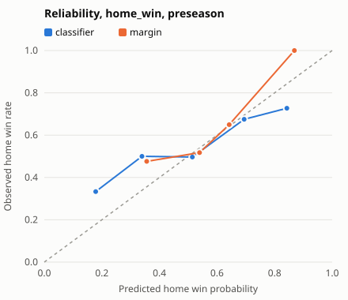

# Preseason home_win, 2015-16 to 2019-20

- **Games:** 366 preseason games, 2015-16 to 2018-19 (2019-20 has no preseason games in the DB, #25)
- **Command:** `avaris preseason-win-check` on a 2026-10-14 snapshot of the DB; one refit per season (ADR-023)
- **classifier:** the kept `home_win` rung; **margin:** P(margin > 0) under the kept `margin` rung's N(mu, sigma), sigma from the preseason bucket
- **CIs:** 95% percentile bootstrap over games (1000 replicates); `diff` is margin minus classifier, paired (negative is better, except accuracy)

## Scores

| metric | model | value | ci | diff |
|---|---|---|---|---|
| log_loss | classifier | 0.6671 | [0.6338, 0.7006] | ref |
| log_loss | margin | 0.6475 | [0.6238, 0.6705] | -0.0196 [-0.0390, -0.0001] |
| brier | classifier | 0.2376 | [0.2224, 0.2532] | ref |
| brier | margin | 0.2301 | [0.2193, 0.2408] | -0.0076 [-0.0164, 0.0011] |
| accuracy | classifier | 0.5956 | [0.5491, 0.6448] | ref |
| accuracy | margin | 0.5874 | [0.5383, 0.6393] | -0.0082 [-0.0464, 0.0301] |
| ece | classifier | 0.0482 | [0.0370, 0.1066] | ref |
| ece | margin | 0.0421 | [0.0286, 0.0994] | -0.0062 [-0.0526, 0.0280] |

## Log loss by season

| season | games | classifier | margin |
|---|---|---|---|
| 2015-16 | 108 | 0.7224 | 0.6841 |
| 2016-17 | 101 | 0.6590 | 0.6550 |
| 2017-18 | 78 | 0.6540 | 0.6369 |
| 2018-19 | 79 | 0.6150 | 0.5986 |

## Reliability (5 bins)

**classifier**

| bin | n | mean_p | freq |
|---|---|---|---|
| 0 | 3 | 0.1790 | 0.3330 |
| 1 | 52 | 0.3390 | 0.5000 |
| 2 | 143 | 0.5140 | 0.4970 |
| 3 | 157 | 0.6940 | 0.6750 |
| 4 | 11 | 0.8430 | 0.7270 |

**margin**

| bin | n | mean_p | freq |
|---|---|---|---|
| 1 | 21 | 0.3560 | 0.4760 |
| 2 | 226 | 0.5390 | 0.5180 |
| 3 | 97 | 0.6420 | 0.6490 |
| 4 | 22 | 0.8690 | 1 |

